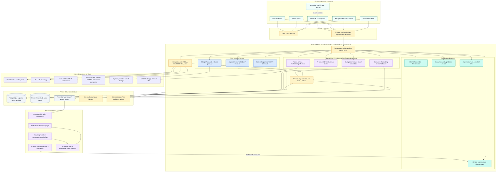
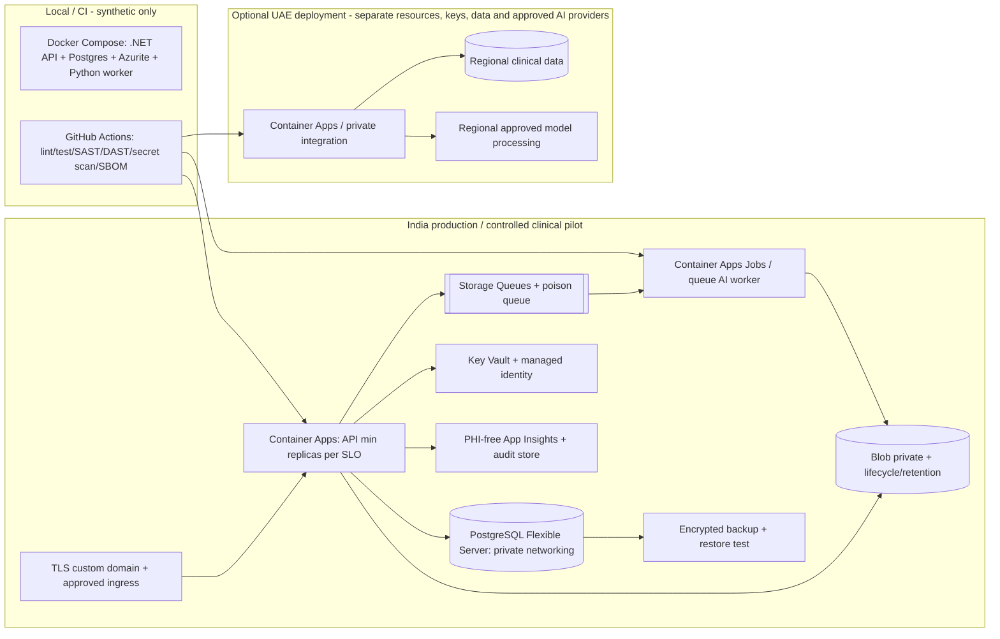
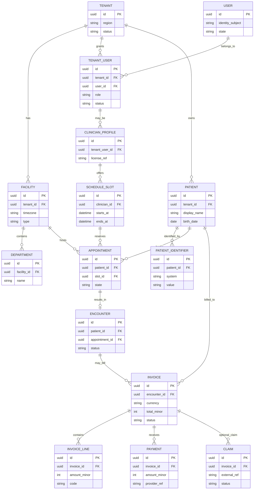
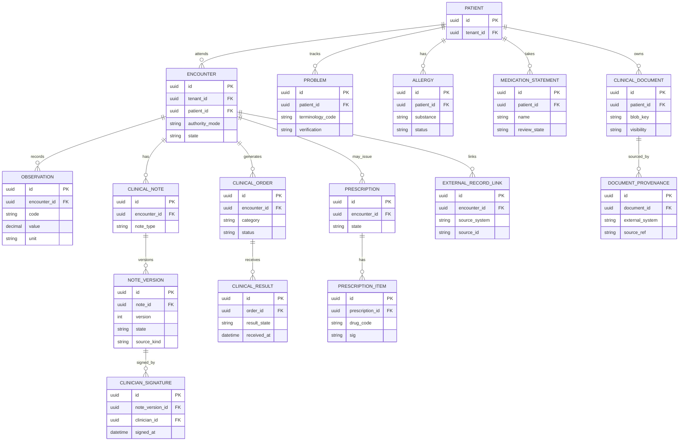
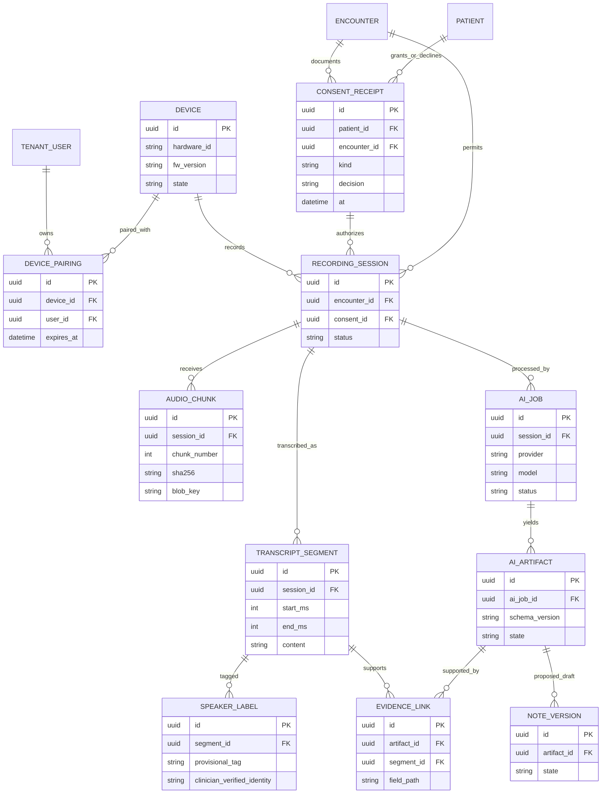
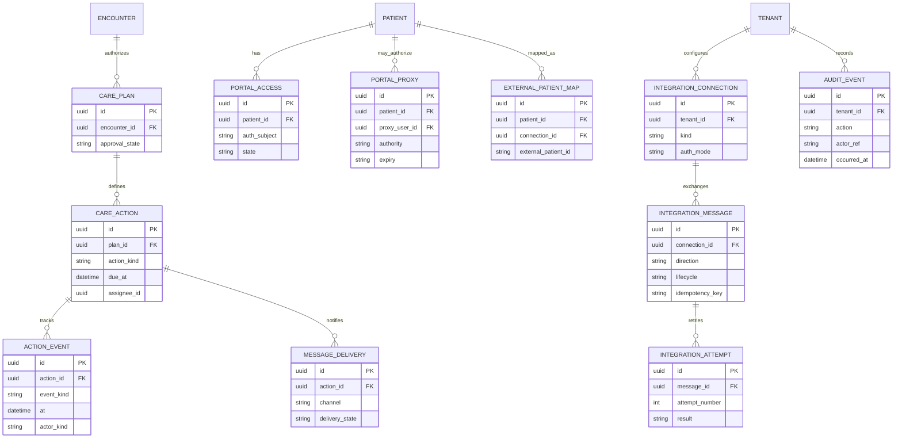
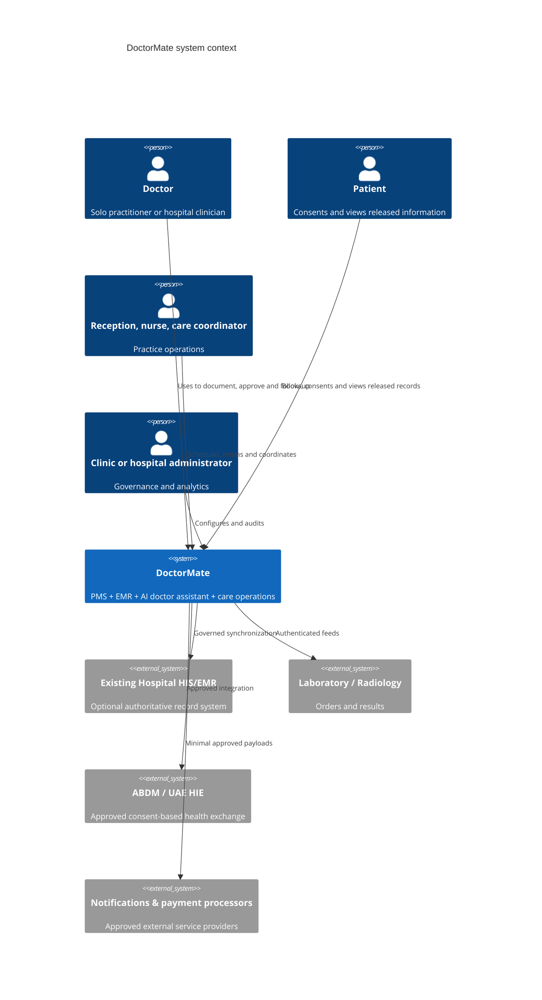
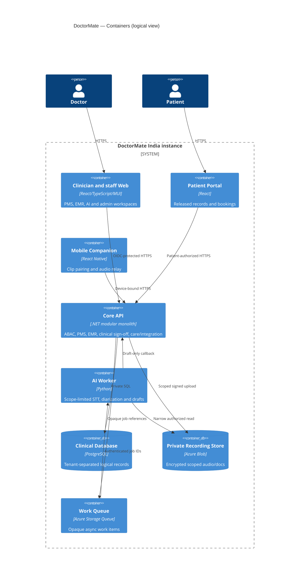
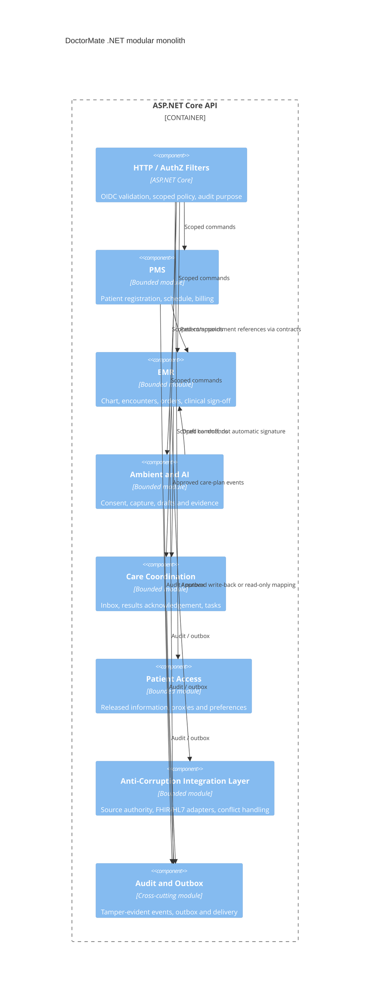

# DoctorMate — Full Product & Software Architecture v2.0

**Date:** 4 October 2026  
**Status:** Design blueprint, NOT a compliant/certified clinical system  
**Working name:** DoctorMate (subject to India/UAE name clearance)  
**Market:** India-first, separate UAE deployment  
**Scope:** Solo doctor → clinic → multi-department hospital; patient portal; optional wearable; lightweight PMS + EMR + AI; integration-first at hospitals.

> **Critical product decision:** A solo doctor gets a complete lightweight PMS/EMR and AI assistance. An enterprise hospital connects AI, patient-facing functions and approved workflows to the hospital's existing HIS/EMR when it remains the system of record. Never create a second, conflicting authoritative chart accidentally.

## 0. What's new in v2

| Block | v1 | v2 changes | First release |
|---|---|---|---|
| A. PMS | Appointments mentioned | Registration, doctor scheduling, reception, waiting room, billing, payment reconciliation, claims adapter boundary, clinic dashboard | M1 appointments/registration; M2 basic billing |
| B. EMR | Encounter & note core | Clinical chart, problem list, allergies, vitals, meds, orders, results, Rx approval, longitudinal provenance, safe record ownership | M1 clinical note & history; M2 medicines/orders/results |
| C. AI Doctor | Ambient drafts | Pre-visit brief, diarization confirmation, evidence-linked editable notes, source conflicts, versioned sign-off, explicit AI state | M1 scribe & approval |
| D. Care coordination | Follow-up tasks | Plan-to-proof tracking, doctor inbox, acknowledgment, escalation and patient notification as separate events | M2 |
| E. Device | Clip recording | Phone-first + optional clip, device lifecycle/firmware, encrypted upload buffer, consent/session binding, private voice mode | M1 phone, M3 clip |
| F. Patient | Minimal portal | Booking, consent, care instructions, report access, language preferences, caregiver/proxy policies | M2 |
| G. Enterprise | HIS connectors | Department/facility scopes, HL7 FHIR R4 adapter, HL7 v2 where supported, ABDM and UAE HIE adapters, SSO, enterprise audit | M4 |
| H. Security | Cross-cutting | Formal privacy/security design, dual-region isolation, no PHI telemetry, scoped authorizations, retention, recovery, threat modeling | From day 0 |

### Scope and terminology

- **PMS** = Practice Management System (some suppliers call it Patient Management System). It governs registration, appointments, visit logistics, billing and clinic operations.
- **EMR** = Electronic Medical Record. The chart, signed encounters, conditions, allergies, medication orders, lab orders/results and clinician-controlled clinical information.
- **HIS/HMS** = Hospital Information/Management System. Can own both PMS and EMR, plus pharmacy, inpatient and administrative modules. Integrate rather than replace first.
- **EMS** is ambiguous (it often means Emergency Medical Services); use **EMR** in product labels, documentation and contracts.
- **AI outputs are drafts.** No diagnosis, orders, signed note or EMR write-back becomes authoritative without required licensed clinician approval.

## 1. Ten architectural decisions

1. **Modular monolith:** ASP.NET Core .NET 10 API with separately testable bounded contexts and one PostgreSQL server (schemas per module) for v1; avoid distributed transactions and premature microservices.
2. **Separate AI worker:** Python/FastAPI process, asynchronous queue, no unrestricted database permissions; consumes scoped recording/documents and returns versioned draft-only callbacks.
3. **Clear data authority:** Every tenant sets patient/encounter/clinical-record ownership: `DOCTORMATE` for solo practice or `EXTERNAL_HIS` for hospital integration. Controlled copies explicitly labeled synchronized, with provenance and conflict handling.
4. **Phone-first capture:** Mobile/desktop microphone before custom wearable; later clip pairs to mobile companion, authenticates per session, stores only encrypted chunks and uses an always-visible recording light.
5. **Explicit recording consent:** Patient-specific informed consent before each applicable capture; manual documentation always available. Distinguish patient's consent to treatment, recording, external disclosure, reminders and marketing.
6. **Separate India/UAE data planes:** Separate subscriptions, resource groups, storage, model processing endpoint, logs, backups and identity arrangements when legally/contractually required. No shared PHI datastore.
7. **Provenance-first chart:** Original source documents, transcript segments, clinician edits, timestamps and signing events are versioned; AI cannot invent negative findings or medication dosage.
8. **Closed-loop results:** Ordered → sampled/performed → received → verified/matched → assigned → acknowledged → patient contacted → completed. State changes require actor, time and receipt, not merely successful message delivery.
9. **Minimum least privilege:** OIDC+MFA, tenant+facility+role+relationship+purpose checks, scoped time-limited blob upload, encryption, immutability-oriented audit, break-glass with justification and heightened review.
10. **Evolve only on evidence:** Add Redis, search service, orchestration platforms, managed FHIR service, isolated databases and dedicated real-time gateways when observed workload or enterprise contract justifies cost.

## 2. Full application architecture



**Trust boundaries:** external clients → edge; edge → tenant-scoped API; API → private data; queue → AI worker; integration adapter → external HIE/HIS; India ↔ UAE deployments: **no routine PHI flow**. Diagram arrows represent logical interfaces, not permission grants.

## 3. Deployment architecture and low-cost Azure model



| Stage | Typical design | Indicative monthly infrastructure budgeting* | Live PHI? |
|---|---|---|---|
| Dev/demo | Laptop Docker, synthetic fixtures, cheap stateless test site | $0–$70 | No |
| Controlled India pilot | Small private PostgreSQL, Blob, Container Apps API, event-triggered worker, vault, backup/logs | **$150–$500** plus inference/SMS | Only after security/legal/clinical readiness gate |
| Small paid clinics | More API capacity, retention/recovery testing, optional advanced networking | $400–$1,200+ plus inference/support | Yes after controls pass |
| Hospital / UAE | Separate infra per country, advanced networking, audited SSO, integration, SLO and support | Quote from capacity/security requirements | Yes only in approved deployment |

*Illustrative planning estimates, **not** Azure quotes; region, uptime, networking, storage, logging, inference and backup dominate costs. A scale-to-zero API may reduce demos' idle expense but introduces cold start. For clinical production, select a minimum healthy instance according to the required availability. Private PostgreSQL networking and Container Apps VNet integration must be configured together and priced before committing.*

**Current service references to recheck at deployment:** https://learn.microsoft.com/en-us/azure/container-apps/billing ; https://learn.microsoft.com/en-us/azure/postgresql/network/concepts-networking-private . No public database endpoint in the clinical pilot; if an exception is temporarily required in non-production, scope it tightly and remove it before PHI is accepted.

## 4. Logical bounded contexts and authoritative ownership

| Context | Tables/scope | Writes owned | What it must never do |
|---|---|---|---|
| Identity/Tenant | tenants, facilities, memberships, grants | Staff, clinicians, privileges | Allow cross-facility access by role alone |
| PMS | patient registration, appointment, queue, billing, receipt | Administrative workflow | Modify signed clinical records |
| EMR | encounters, observations, problems, allergies, medications, prescriptions, orders, results, notes | Clinician-signed chart | Trust AI drafts as signed facts |
| Ambient & Device | devices, consent receipts, sessions, recording chunks, transcripts | Capture events, not final clinical facts | Record without encounter/consent |
| AI & Source Evidence | ai_jobs, artifacts, draft fields, evidence spans | Provisional AI data | Issue prescriptions, finalize results or sign |
| Care coordination | care plans, follow-ups, assignments, acknowledgements | Clinician-authorized action tracking | Mark delivered message as completed care |
| Patient portal | portal identities/proxies, consent views, comm preferences | Patient-authorized actions | Expose internal/unreviewed AI notes |
| Integration | systems, mappings, inbound/outbound messages, retry state | Transport state and provenance | Unverified patient matching or silent overwrite |
| Audit/Security | audit events, access purposes, break-glass actions | Independent audit stream | Put PHI into logs/search/traces |

**Transactional boundaries:** a registration can create patient+appointment atomically; a signed note and its outbox event commit together; cross-system exports use asynchronous retries with idempotency and conflict review. AI worker never has direct broad data access.

## 5. Complete proposed repository structure

```text
DoctorMate/
├── README.md / AGENTS.md / SECURITY.md / CONTRIBUTING.md
├── .github/workflows/{ci,security,preview,deploy-india,deploy-uae}.yml
├── apps/
│   ├── clinician-web/                      # React 19 TS MUI: doctor/nurse/reception
│   │   ├── src/app/{router,auth,theme,providers}
│   │   ├── src/layouts/{doctor,reception,nurse,admin,patient}
│   │   ├── src/features/
│   │   │   ├── identity-onboarding/
│   │   │   ├── pms/{registration,appointments,check-in,queues,billing,insurance}
│   │   │   ├── emr/{patient-360,encounters,vitals,conditions,allergies,meds,
│   │   │   │        prescriptions,orders,results,clinical-notes,documents,timeline}
│   │   │   ├── ai/{previsit-brief,consent,capture,live-transcript,speakers,
│   │   │   │       note-review,source-evidence,voice-command,quality-feedback}
│   │   │   ├── care/{plans,followups,lab-inbox,escalations,communications}
│   │   │   ├── devices/{pairing,health,firmware,sessions}
│   │   │   ├── enterprise/{facilities,users,departments,integrations,audit,analytics}
│   │   │   └── shared/{errors,loading,empty-states,accessibility}
│   │   ├── src/{entities,shared,styles,locales}
│   │   └── tests/{unit,integration,e2e,a11y,security}
│   ├── patient-portal/                     # Separate small React web/PWA
│   │   └── src/features/{bookings,records,consents,reports,care-plans,messages,proxy}
│   ├── mobile-companion/                   # React Native + native BLE/audio bridge
│   │   └── src/{pairing,encounter-binding,recording,offline-buffer,sync,firmware}
│   └── api/
│       ├── DoctorMate.Api/{Endpoints,Middleware,Authorization,OpenApi}
│       ├── DoctorMate.Application/{Abstractions,Behaviors,Outbox}
│       ├── DoctorMate.Infrastructure/{Persistence,Blob,Queue,KeyVault,Telemetry}
│       ├── DoctorMate.Contracts/{Events,ApiDtos,Schemas}
│       ├── Modules/
│       │   ├── DoctorMate.Modules.Identity/{Domain,Application,Infrastructure,Contracts}
│       │   ├── DoctorMate.Modules.PMS.Registration/{Domain,Application,Infrastructure,Contracts}
│       │   ├── DoctorMate.Modules.PMS.Scheduling/{Domain,Application,Infrastructure,Contracts}
│       │   ├── DoctorMate.Modules.PMS.Billing/{Domain,Application,Infrastructure,Contracts}
│       │   ├── DoctorMate.Modules.EMR.Chart/{Domain,Application,Infrastructure,Contracts}
│       │   ├── DoctorMate.Modules.EMR.Encounters/{Domain,Application,Infrastructure,Contracts}
│       │   ├── DoctorMate.Modules.EMR.OrdersResults/{Domain,Application,Infrastructure,Contracts}
│       │   ├── DoctorMate.Modules.EMR.Prescribing/{Domain,Application,Infrastructure,Contracts}
│       │   ├── DoctorMate.Modules.AI.Recording/{Domain,Application,Infrastructure,Contracts}
│       │   ├── DoctorMate.Modules.AI.ClinicalDrafts/{Domain,Application,Infrastructure,Contracts}
│       │   ├── DoctorMate.Modules.CareCoordination/{Domain,Application,Infrastructure,Contracts}
│       │   ├── DoctorMate.Modules.PatientPortal/{Domain,Application,Infrastructure,Contracts}
│       │   ├── DoctorMate.Modules.DeviceManagement/{Domain,Application,Infrastructure,Contracts}
│       │   ├── DoctorMate.Modules.Integrations/{Domain,Application,Infrastructure,Contracts}
│       │   └── DoctorMate.Modules.AuditCompliance/{Domain,Application,Infrastructure,Contracts}
│       └── tests/{Unit,Integration,Security,Architecture,Contract,Migration}
├── services/ai-worker/
│   ├── app/{api,orchestration,stt,diarization,language,extractor,grounding,
│   │        safety,provider_adapters,consent_validator,schema_validator}
│   └── tests/{unit,medical_eval,adversarial,synthetic_multispeaker}
├── firmware/clip-esp32-s3/{main,components,secure-boot,ota,test}
├── packages/{ui,design-tokens,api-client,fhir-mapping,medical-terminology,
│            accessibility,synthetic-fixtures}
├── contracts/{openapi,asyncapi,jsonschema,fhir-r4,hl7v2}
├── infra/
│   ├── bicep/{modules,environments/{dev,india-pilot,india-prod,uae-prod}}
│   ├── docker/{api,ai-worker,local-postgres}
│   └── deployment/{backup-restore,runbooks,secrets-rotation,incident-response}
├── docs/
│   ├── architecture/{blueprint-v2,c4,erd,adrs,threat-model}
│   ├── product/{roadmap,roles,journeys,screen-inventory,acceptance-criteria}
│   ├── design/{claude-design-master-prompt,design-tokens,wireframe-checklist}
│   ├── compliance/{india,uae,consent,retention,data-map}
│   └── clinical/{safety,record-authority,evaluation,sign-off-policy}
└── tools/{seed-synthetic-data,contract-checker,clinical-evaluation,access-test}
```

## 6. Database ERD — A: tenant, practice management and billing

Rules: UUID keys; all tenant data includes `tenant_id`; facility scope where applicable; database constraints and RLS in addition to server-side policy. Match registered patient identity without deduping on phone number alone. Money use integer minor units and currency codes, never float.



## 7. Database ERD — B: EMR, chart and clinical authority



**EMR invariants:** unsigned note version is visibly DRAFT; signed note immutable (correction by signed addendum); allergies clearly distinguish confirmed, reported, unknown and not assessed; orders and Rx require proper authorization; results cannot be automatically presented as reviewed.

## 8. Database ERD — C: clip, consent, transcript, AI and evidence



**Privacy:** consent has jurisdiction and policy-version references; audio retention is per tenant/purpose; delete and downstream vendor purge workflows are explicit. The AI source snapshot remains accessible only to authorized users, not to the model indefinitely.

## 9. Database ERD — D: care, patient portal, integrations and audit



Use module-specific migrations and database schemas (`iam`, `pms`, `emr`, `ambient`, `care`, `portal`, `integration`, `audit`). Cross-module references are by immutable UUID and published domain events; avoid circular ORM aggregate dependencies. In the single database phase, selected cross-schema FK constraints may protect referential integrity where migrations can enforce ownership predictably.

## 10. Clinical consultation sequence — full doctor-to-record workflow

```mermaid
sequenceDiagram
 autonumber
 actor Patient
 participant Doctor as Doctor UI
 participant PMS as PMS
 participant EMR as EMR
 participant Clip as Phone/Clip
 participant Capture as Recording API
 participant Blob as Private Blob
 participant Queue as Work Queue
 participant AI as Isolated AI Worker
 participant HIS as External HIS/EMR (optional)
 Doctor->>PMS: Select appointment / identify patient
 PMS-->>Doctor: Verified patient + encounter context
 Doctor->>EMR: Open chart and prior history
 EMR-->>Doctor: Verified facts + provenance + unresolved conflicts
 Patient->>Doctor: Grant or decline recording consent
 Doctor->>Capture: Record consent receipt
 alt Consent declined
  Doctor->>EMR: Document manually
 else Consent valid
  Doctor->>Clip: Explicit start; LED ON
  Clip->>Capture: Device-bound authenticated session
  Capture-->>Clip: Scoped short-lived upload capability
  loop Encrypted audio chunks
   Clip->>Blob: Upload encrypted chunk
   Clip->>Capture: Chunk manifest/integrity hash
  end
  Doctor->>Clip: Stop capture; LED OFF
  Capture->>Queue: Queue authorized opaque job ID
  Queue->>AI: Authorize/recheck consent and permissions
  AI->>Blob: Read only authorized chunks
  AI-->>Capture: Transcript, provisional speakers, structured draft + evidence IDs
  Capture-->>Doctor: Review speakers, uncertain content, medications, evidence
  Doctor->>EMR: Edit / approve clinical note, orders and care plan
  EMR->>EMR: Append immutable signed version + audit + outbox
  opt Hospital integration authorized
   EMR->>HIS: Idempotent approved write-back / source-of-truth check
   HIS-->>EMR: Receipt or conflict for clinician review
  end
 end
```

## 11. APIs, authorization and event contracts

`/api/v1` prefix; names illustrative and subject to OpenAPI design review. Enforce `tenant_id`, `facility_id`, role, patient/encounter relationship, purpose of access and license/authorization where relevant on **every** operation; do not accept asserted patient ownership from client input.

| Module | Example endpoints | Auth constraints |
|---|---|---|
| Identity | `POST /sessions/validate`, `GET /me/permissions`, `POST /break-glass` | MFA, explicit break-glass scope + reason |
| PMS registration | `POST /patients`, `GET /patients?query=`, `POST /patients/merge-review` | Reception/clinical roles, facility scope, dedup review |
| PMS appointments | `GET /appointments`, `POST /appointments`, `POST /appointments/{id}/check-in` | Facility schedule permissions, no unauthorized notes |
| PMS billing | `POST /invoices`, `POST /invoices/{id}/payment-intents`, `GET /reconciliation` | Cashier/admin, no payment card storage |
| EMR chart | `GET /patients/{id}/chart`, `GET /patients/{id}/timeline` | Treating relationship + audit purpose |
| EMR encounter | `POST /encounters`, `POST /encounters/{id}/observations` | Assigned staff/doctor, immutable actor attribution |
| EMR note | `POST /encounters/{id}/notes/draft`, `POST /notes/{id}/sign`, `POST /notes/{id}/addendum` | Clinician-only sign, signed version immutable |
| EMR orders | `POST /encounters/{id}/orders`, `GET /patients/{id}/results` | Licensed approver, no AI autonomous release |
| Capture | `POST /encounters/{id}/consents`, `POST /recording-sessions`, `POST /recordings/{id}/complete` | Verified current encounter, valid consent, device/actor binding |
| AI | `POST /ai-jobs`, `GET /ai-jobs/{id}`, `GET /notes/{id}/evidence` | Scoped internal job + visible draft watermark |
| Care | `POST /care-plans`, `POST /care-actions/{id}/acknowledge`, `GET /inbox` | Clinical assignment, patient-context permission |
| Portal | `GET /portal/records`, `POST /portal/appointments`, `POST /portal/consent` | Patient/proxy self-scoping + released documents only |
| Integration | `POST /integrations/{id}/sync`, `GET /integrations/{id}/status` | Service identity + admin, conflict resolution queue |
| Devices | `POST /devices/pair`, `POST /devices/{id}/bind-encounter`, `POST /devices/{id}/revoke` | Short-lived pairing, hardware identity verification |
| Security | `GET /audit/access` | Compliance officer, tamper-evident export |

**Domain events:** `PatientRegistered.v1`, `AppointmentCheckedIn.v1`, `EncounterOpened.v1`, `ConsentRecorded.v1`, `RecordingCompleted.v1`, `AiDraftReady.v1`, `ClinicalNoteSigned.v1`, `OrderApproved.v1`, `ResultReceived.v1`, `ResultAcknowledged.v1`, `CareActionDue.v1`, `IntegrationWritebackConfirmed.v1`. Use outbox, schema version, idempotency key and opaque references; never place PHI in queue messages.

## 12. Security, privacy, clinical safety and compliance

| Layer | Mandatory minimum | Enterprise additions |
|---|---|---|
| Product identity | MFA for clinical/staff roles; passkeys where provider supports; idle timeout; device revocation | SSO SAML/OIDC, SCIM, conditional access |
| Authorization | Tenant+facility+patient relationship+purpose+role ABAC, explicit 403, audited break-glass | Dedicated integration scopes, external privileged access review |
| Data | TLS 1.2+/modern ciphers, platform encryption at rest, Key Vault, private blob, encrypted backup | CMKs/HSM on contract, verified tenant isolation |
| Network | No public PostgreSQL; secure ingress; minimum exposed endpoints; scoped upload tokens | WAF, private endpoints, DDoS considerations and private links |
| Clip | Explicit start/stop, visible LED, bound encounter, signed firmware plan, secure boot/OTA where supported | Enterprise provisioning, lifecycle inventory, fleet patch monitoring |
| Audio and AI | Session-limited consent, retained only per policy, regional provider checks, prompt-injection defense on documents, no training reuse without separate lawful basis | AI-vendor BAAs/DPAs as applicable, model eval board, red-team |
| Clinical | Evidence-linked drafts, unknowns never guessed, clinician sign-off, signed addenda, separate task/result state, hard stop on uncertain patient matching | Specialty-specific evaluation, clinical governance, incident review |
| PMS billing | Payment provider tokenization; payment reconciliation; fraud/rate limits | Hospital ERP integration; financial audit exports |
| Audit | Audit reads and writes to clinical charts, export requests, sign/break-glass, log integrity and alerts | Central SIEM, external auditor evidence packs |
| Patient privacy | Separate treatment/recording/sharing/notifications preferences; caregiver authorization | DSR handling, privacy impact assessment, periodic access certification |
| Supply chain | Signed builds, SAST, dependency/secret/IaC scans, SBOM, reviews and environment promotion | Pen tests, secure SDLC evidence, change management CAB |
| Reliability | PITR + scheduled restore drills, incident response and explicit RPO/RTO targets | Regional DR once legally approved, SLO and on-call |

**India:** map obligations under applicable Indian medical record retention rules, IT and Digital Personal Data Protection Act/Rules commencement phases, ABDM participation requirements where connecting, and clinician/patient consent practices; get qualified legal and clinical review *before* PHI pilot. Avoid assuming ABDM membership replaces your consent and security obligations.

**UAE:** develop a separate lawful data flow and facility-specific integration plan for DHA NABIDH, Abu Dhabi Malaffi or MOHAP Riayati as applicable, with regional data processing, vendor contracts and local regulatory/legal validation. UAE healthcare data localization and any permitted exceptions must be evaluated specifically, including inferencing, transcription, logs, backups and remote support. Do not share patient records across India/UAE by default.

**Explicit failure modes UI must show:** no consent → manual notes; disconnected clip → pause/secure buffer; low-quality audio → request re-record/edit; uncertain speaker → no identity assertion; wrong-patient suspicion → stop/lock session; AI outage → editable manual note; conflicting imported record → highlight authoritative source; late test result → accountable review queue; emergency symptoms → appropriate emergency warning, not autonomous triage.

## 13. Functional product blocks and phased MVP

| Phase | Named release | Deliverables | Release gate |
|---|---|---|---|
| M0, 2–3 weeks | Design and safety foundation | User research, clickable wireframes, data map, security threat model, dummy fixtures, role matrix, clinical review rubric | Doctor validates core flows, privacy/legal approval for real-data plan |
| **M1, 8–12 weeks** | **Doctor-first MVP** | Solo onboarding, registration, calendar/check-in, patient chart/history, encounter/consent, phone/desk capture, transcription and provisional speakers, evidence-linked note review, manual note fallback, clinician sign, PDF/export, basic audit | 5–10 controlled clinicians, safe capture + sign tests, scoped access |
| M2, 8–12 weeks | Clinic PMS/EMR + care | Reception queues, vitals, problem/allergy/med lists, orders/results entry, prescriptions under doctor control, basic billing/reconciliation, follow-up engine, reviewed results inbox, minimal patient portal and reminders | E2E care-task closure, billing balance, no missed critical results |
| M3, 6–10 weeks after hardware stable | Wearable + advanced AI | Clip provisioning, BLE pairing, encrypted offline buffer, 2-way private voice, multilingual eval, speaker confirmation, pre-visit summary, stronger AI QA | Device/consent/offline/overlap tests pass, clinician trust metrics |
| M4, 3–6 months | Hospital enterprise | External HIS authoritative integration, lab feeds, ABDM where approved, enterprise SSO, department/facility RBAC, audit exports, analytics, migration/adapters, UAE independent deployment | Hospital integration contract, security review, clinical sign-off |
| Later | Specialty intelligence | Specialty templates, validated chronic disease workflows, optional patient care navigation and analytics | Clinical evidence, consent and regulatory classification review |

Do not present dates as promises: staffing, interoperability access, regulatory review and hospital procurement are significant dependencies.

## 14. UX system: roles, navigation and screen inventory

**Visual hierarchy:** clinical alert/warning > current patient identity > clinical action > documentation > operations; no pastel styling that hides critical status. Don't use color alone to indicate allergies, unverified AI, or urgent results. WCAG 2.2 AA targets, keyboard and screenreader support, 200% zoom and print-friendly prescriptions.

### Personas and app shells

- **Solo doctor:** home → schedule → patient search/chart → consultation → reviewed note/Rx → follow-up → billing → settings.
- **Receptionist:** daily calendar → registration/dedup → check-in/queue → invoice/payment → call next patient.
- **Nurse:** rooming list → patient verification → vitals/allergies → encounter handoff → delegated care tasks.
- **Hospital clinician:** external HIS-linked appointment list, governed chart view and draft write-back statuses.
- **Care coordinator:** result inbox, overdue tasks, contact outcomes, escalations.
- **Patient/caregiver:** approved booking, identity/proxy, recording consent, released records, instructions and follow-ups.
- **Hospital/clinic admin:** departments, facilities, roles, licenses, device fleet, integrations, revenue overview, access audit, retention policy.

### Screen inventory: must be covered in end-to-end design

1. Landing/pricing/security/integration page; demo request; data-residency trust center.
2. Sign-in/MFA, passwordless recovery, invite acceptance, expired session and access denied.
3. Solo practice onboarding, facility profile, doctor license, schedules, default consent and recording policy.
4. Multi-facility hospital onboarding, department settings, SSO, existing-HIS/record-ownership selector.
5. Doctor Today: appointment summary, patient flags, inbox action, pending notes, device status.
6. Calendar day/week/list; slots, reschedule, no-show, waitlist and recurring appointments.
7. Patient registration/verification, dedup warnings, emergency contact, patient directory and search.
8. Reception check-in and waiting-room board with nonclinical statuses; call/room patient.
9. Nurse rooming, vitals, allergy verification, patient identity and doctor handoff.
10. Patient 360: banner with identity & allergy, diagnoses, meds, history, trends, timeline, documents, pending actions, source provenance.
11. Encounter preparation: chief complaint, verified vs imported facts, AI pre-visit brief and uncertainty/conflict markers.
12. Consent capture, declined consent/manual fallback, clip pairing, permissions and device readiness.
13. Active recording with clear timer, physical-status sync, pause, consent indicator, speaker provisional tags and battery/network warnings.
14. Stopped recording upload/progress, processing state, audio quality warning, safe retry and session recovery.
15. Editable transcript with timestamps/speaker correction, protected source replay and multilingual original vs translation.
16. Side-by-side AI draft + evidence; SOAP/template switch; unknown fields; clinician correction and provenance warning.
17. Clinical diagnosis/problems, meds reconciliation, allergies, observations, eRx and tests/order composer with mandatory physician sign.
18. Care plan preview: tasks, due dates, owners, patient instructions, patient communication consent and follow-up.
19. Sign & finalize workflow; immutable signed note, addendum, share/export and external HIS write-back success/failure/conflict.
20. Results inbox: inbound report matching, abnormal/unreviewed sorting, physician acknowledgement, escalation and completion tracking.
21. Follow-up board with clear owner/overdue status, contact attempts, lab/order lifecycle and closing evidence.
22. PMS billing: charge capture, invoices, adjustments, payment provider callback, refund/receipt, outstanding/reconciliation.
23. Patient portal: login/proxy, appointments, visit summaries, prescriptions, released results, instructions, messages and privacy controls.
24. Device fleet: setup, pairing, firmware version, update, charging, lost/revoked, offline upload and replacement.
25. Hospital admin: facility/department/user/license management, role permissions, clinical governance, integrations, access audit, security alerts.
26. Analytics: clinician workload, note time saved, follow-up completion, no-shows, revenue, patient outcomes **without overclaiming clinical impact**.
27. Every flow: first-use/empty/error/slow/unauthorized/offline/no-consent/large-text/mobile/print and safe recovery states.

## 15. Design tokens and core visual concept

**Recommended identity** (working product-neutral; rebrand later): deep navy `#102A43`, medical teal `#0E9384`, action blue `#2563EB`, violet AI `#7155D8`, surface `#F7FAFC`, clinical danger `#C73740`, amber caution `#B7791F`. Teal = completion and primary brand, blue = navigation/actions, violet = *provisional AI only*, amber/red = medical attention (with icons/text). Light theme is primary for clinical use; dark theme is an accessible optional secondary. Font: Inter/Manrope for UI, fallback system; tabular numerals for labs and vitals. 8-point spacing, 44px touch targets, comfortable tables, subtle borders, generous whitespace, explicit information hierarchy.

## 16. QA/test strategy, observability and change management

- **Clinical safety tests:** AI hallucination on absent negatives; medicine dose uncertainty; speaker overlap and wrong assignment; noisy Hindi–English consultations; wrong-patient warnings; rejected and amended notes; signed immutability; result not auto-acknowledged.
- **Security tests:** IDOR, tenant isolation, facility scope, impersonation, revoked device, expired upload grant, replayed chunk IDs, injection through PDF/transcript, export abuse, PHI telemetry scanner and support impersonation controls.
- **PMS/EMR contract tests:** no duplicate invoice from retry, successful provider callback, patient dedup manual review, no unauthorized order, external HIS conflict and idempotent retry, incoming lab wrong MRN.
- **Accessibility and end-to-end:** Playwright for critical paths, visual regression on dense clinical charts, WCAG 2.2 AA checks, manual screenreader review and keyboard operability.
- **Operational tests:** PITR restore drill, queue poison/replay, AI outage/manual fallback, clip loss/offline sync, cloud model quota and sensitive-data egress testing.
- **Metrics:** note draft-to-sign time; correction rate; evidence-supported field rate; recorded consent coverage; overdue unreviewed result count; follow-up completion; action ownership; availability and unit costs per encounter. Metrics should use aggregate or deidentified telemetry where feasible.

## 17. Architecture decision records and implementation gates

| ADR | Decision | Revisit when |
|---|---|---|
| 001 | Modular .NET monolith + isolated AI worker | Independent scaling/legal boundary warrants split |
| 002 | PostgreSQL with schemas + RLS | Large tenant isolation or compliance mandates database-per-tenant |
| 003 | Voice model provider abstraction | Pricing, residency, language QA or contract changes |
| 004 | Clinician-only signature/approved write-back | Never bypass; specialty/legal governance required for policy change |
| 005 | Phone-first, custom clip later | Device reliability and market demand demonstrated |
| 006 | India/UAE separate deployments | Legal authority establishes narrow cross-border exchange |
| 007 | Outbox + Storage Queue | Ordered workflows/SLA justify Service Bus |
| 008 | Own-lightweight-EMR vs external-HIS authority flag | Hospital integration readiness/specific contract |
| 009 | Explicit result acknowledgment state | Never conflate message delivery and clinical review |

## 18. C4 model — at the end by design

### C4 Level 1 — System context



### C4 Level 2 — Containers



### C4 Level 3 — Core API components



### C4 quality review and diagram applicability

C4 describes logical systems, not network security. Pair Level 2 with the physical Azure deployment, data-flow and trust-boundary diagrams above. Mermaid C4 support differs by Markdown renderer: a viewer without C4 support should use supplied PNG/SVG architecture images or Mermaid-compatible documentation tooling. Device firmware is represented as an external edge client; a device-specific component diagram can be added once the hardware specification is stable.

---

**Approval checkpoint:** This blueprint is suitable for planning and prototyping but is not a certification claim, a regulatory legal opinion or production-ready clinical software. Obtain clinical governance, privacy/legal, penetration-test and infrastructure sign-off before a real-patient pilot.
