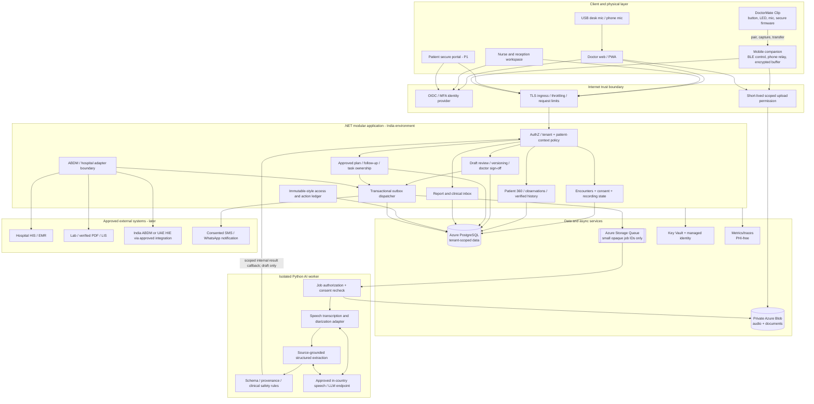
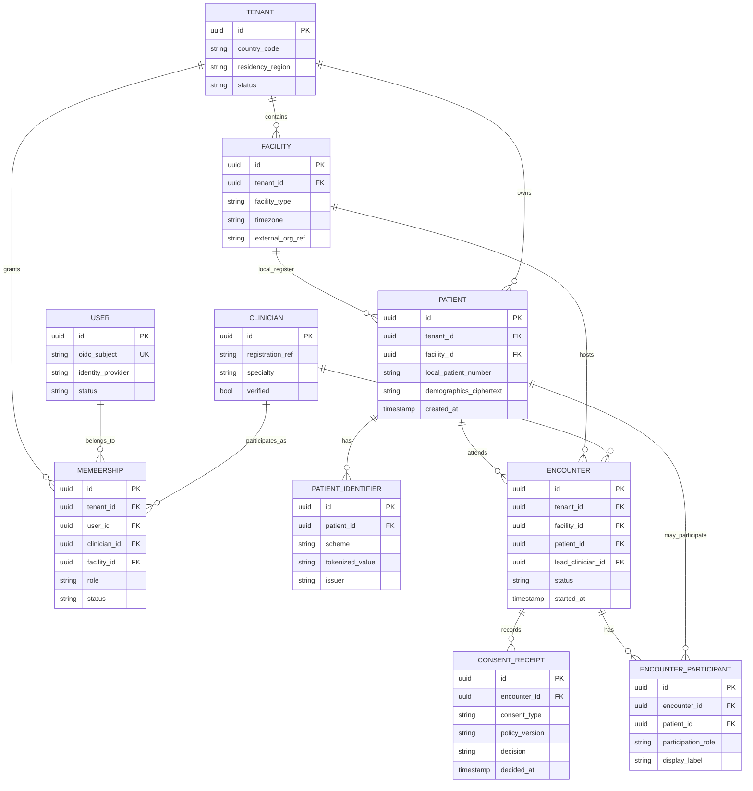
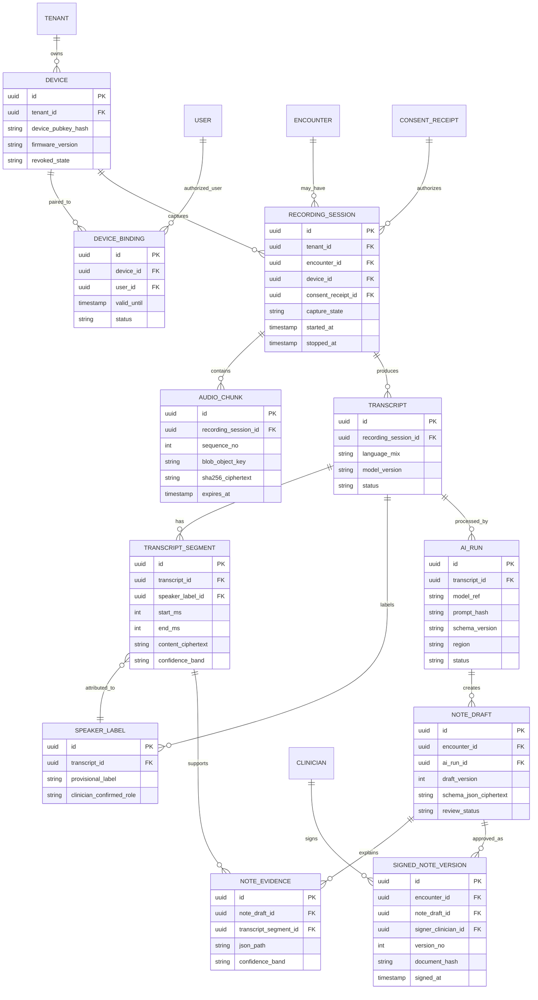
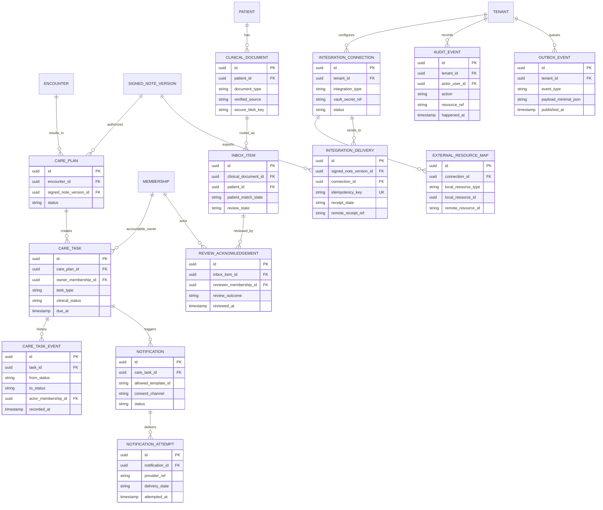
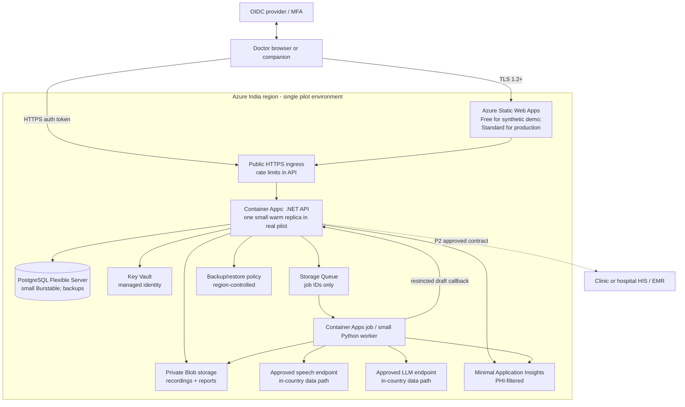

# DoctorMate — Software Architecture, Repository Structure, ERD & Azure Deployment

**Version:** 1.0 · **Date:** 3 October 2026 · **Status:** Implementation blueprint, subject to clinical, legal and security design review  
**Product name:** DoctorMate (working name; trademark/name clearance pending)  
**Primary market:** India · **Expansion:** UAE with a separate regulated deployment  
**Primary customers:** Solo doctors → small clinics → multi-specialty clinics → hospital departments  
**Clinical scope:** Human-reviewed documentation, accessible patient history and clinician-directed care coordination; **not** autonomous diagnosis, prescribing or emergency triage.

> **Architecture decision:** Build a **modular .NET monolith** with a separate, queue-driven AI worker and an optional mobile companion for DoctorMate Clip. Put hard domain, security and audit boundaries in the code now; buy expensive networking, high availability, managed FHIR and microservices only when evidence and hospital contracts justify them. A solo doctor must be able to use the product without a wearable, hospital integration or patient app.

---

## 1. Executive architecture decisions

| Decision | Start here | Upgrade trigger |
|---|---|---|
| System shape | One ASP.NET Core / .NET 10 API, modular monolith | Split only a measured bottleneck or separately governed deployment |
| Doctor frontend | React 19 + TypeScript + MUI, responsive web/PWA | No rewrite needed |
| Wearable companion | React Native + narrowly scoped native BLE/audio modules; **prototype Wi-Fi audio or wired/phone recording first** | Native Kotlin/Swift for reliability as clip firmware stabilizes |
| Patient frontend | Small responsive secure web portal, **P1** | Full patient app only if adoption merits it |
| AI | Python worker + interchangeable speech, diarization and LLM provider adapters | Separate low-latency realtime gateway for voice assistant, if demonstrated need |
| Data | Managed PostgreSQL with strict `tenant_id` scope, row-level security defense in depth, UUID primary keys | Partitioning, replicas, tenant-specific DBs for contracted hospitals |
| Files/audio | Azure Blob Storage; **private**, encrypted, short-lived upload credentials | Dedicated storage per large enterprise tenant |
| Async jobs | Transactional Postgres outbox → Azure Storage Queue; idempotent jobs and poison queue | Service Bus if ordered enterprise workflows demand it |
| Identity | Trusted OIDC identity provider + MFA; verify its residency/subprocessor options | Customer SSO via OIDC/SAML, SCIM lifecycle |
| Secrets | Azure Key Vault + managed identities, no hardcoded credentials | HSM/customer-managed keys where contractual requirement |
| Telemetry | Minimal Application Insights / OpenTelemetry; **no PHI in telemetry** | Longer retention and SIEM for enterprise |
| Interoperability | Internal clinical domain + FHIR-R4 translation adapter | ABDM compliant gateway/approved HIP/HIU flow; named HIS/EMR adapters |
| Countries | India and UAE **separate subscriptions/resources/data stores and model endpoints** | No global PHI replication by default |

### Nonnegotiable patient-safety constraints

1. **No clinician approval = no signed note, order, patient instruction or EMR write-back.**
2. Capture starts only for the **verified current encounter** after the required consent notice/action; visible device LED and app indicator stay on throughout capture.
3. Identifying the *speaker* is not proof of *identity*: labels `speaker_1`, `speaker_2` remain provisional until clinician-confirmed. Family members never inherit the patient's identity.
4. Every material generated clinical field retains original source evidence (transcript segment or reviewed document reference). Missing/unclear information stays **unknown**, never silently guessed.
5. An order being drafted, a reminder being sent, a result arriving, a result being reviewed, and a patient being contacted are **different states**.
6. A hospital's patient data is not a physician's automatically portable personal account data. Contract-specific authority determines access and transfer.
7. No unapproved cross-border PHI movement, including **AI inference, speech services, backups, support access and telemetry**.

---

## 2. Whole-product application architecture

The diagram is Mermaid and renders in GitHub Markdown; a separate PNG overview is also provided for non-Mermaid viewers.



### Trust boundaries

- **Device/phone → cloud:** untrusted edge, mutual device binding, scoped upload, authenticated encounter context, TLS and replay rejection.
- **Browser → API:** authentication is not authorization. Every request checks tenant membership, facility, role, patient relationship, purpose and encounter state.
- **Application → AI:** bounded input, no unrestricted tool calls, no automatic authority to sign or dispatch an order, one permitted AI provider per environment.
- **Application → hospital:** contract-governed integration with least-privilege technical identity, explicit patient/encounter matching, idempotent write-back and a confirmed receipt.
- **Monitoring:** diagnostic traces may carry opaque job IDs, timings and error types but never raw transcript/audio, patient names, ABHA, MRN or clinical text.

---

## 3. Clinician workflow and hardware/AI data flow

```mermaid
sequenceDiagram
  autonumber
  actor Patient
  participant Doctor as Doctor/PWA
  participant Clip as Clip + mobile app
  participant API as .NET API
  participant Blob as Private Blob
  participant Q as Storage Queue
  participant AI as Python AI worker
  participant DB as PostgreSQL
  participant HIS as Hospital EMR (optional)

  Doctor->>API: Select verified patient and open encounter
  API-->>Doctor: Current encounter + recording policy
  Patient->>Doctor: Provide or decline informed consent
  Doctor->>API: Record consent decision and source
  API->>DB: Write scoped consent receipt + audit event
  alt Consent declined
    API-->>Doctor: Manual documentation only
  else Consent valid
    Doctor->>Clip: Explicit Start; visible LED ON
    Clip->>API: Device-bound session start, nonce, encounter ID
    API-->>Clip: Short-lived scoped upload capability
    loop Short encrypted chunks
      Clip->>Blob: Upload encrypted chunks via phone relay
      Clip->>API: Chunk manifest, integrity hash, sequence
    end
    Doctor->>Clip: Stop capture; LED OFF
    Clip->>API: Final manifest and device attestation result
    API->>DB: Recording state READY + outbox event
    API->>Q: Queue opaque transcription job ID
    Q->>AI: Authorized job ID
    AI->>API: Recheck consent, tenant and retention policy
    AI->>Blob: Get scoped permitted audio
    AI->>AI: ASR + diarization + grounded draft
    AI->>API: Scoped internal callback with transcript/draft + evidence
    API->>DB: Validate job, tenant, consent and save draft
    API-->>Doctor: Draft available; uncertainty visible
    Doctor->>API: Review, correct and digitally sign note
    API->>DB: Append signed immutable version + audit
    API->>Q: Optional EMR sync / follow-up task
    opt Named EMR integration approved
      API->>HIS: Signed note with idempotency and match checks
      HIS-->>API: Receipt or explicit error
      API-->>Doctor: Confirmed synced / pending / failed state
    end
  end
```

**Realtime versus accurate medical records:** display provisional realtime captions if a supported model/region and network permit; generate the **authoritative draft from a completed recording** using the best validated transcription + diarization pipeline. Provisional captions must never automatically populate a signed clinical record. During poor connectivity, capture only with an approved encrypted, bounded offline policy and an explicit sync state.

**AI worker privilege:** The worker receives opaque job IDs, re-checks authorization through the API and fetches only a time-limited audio object. It never receives a broad PostgreSQL role; it submits transcript/draft results through a restricted, authenticated internal callback.

**Technical limitation of the low-cost ESP32-S3 prototype:** Bluetooth LE is primarily the control/pairing path. Do not assume it is a standard Bluetooth microphone or that it supports ordinary hands-free audio. Initial full-fidelity audio can use Wi-Fi where feasible or a phone/USB microphone; later validate a custom BLE audio stream for bandwidth, packet loss and phone background restrictions. If the doctor asks the assistant a question, show text first; optionally play private responses via the **phone-connected earpiece**, not a speaker exposing patient information in a ward.

### Capture finite-state machine

`UNPAIRED → PAIRED → IDLE → CONSENT_VERIFIED → CAPTURING ↔ PAUSED → STOPPED → SYNCING → READY → PROCESSING → DRAFT_READY → REVIEWED → SIGNED → [EMR_PENDING → EMR_CONFIRMED | EMR_FAILED]`.

Exceptional transitions: `CONSENT_REVOKED` terminates capture, `PATIENT_CHANGED` always requires a new encounter and consent check, `TRANSFER_INTERRUPTED` resumes only missing sequence-numbered chunks, `DEVICE_LOST` revokes trust and encryption keys/tokens as applicable. No recording is attachable to two active encounters.

---

## 4. Modular-monolith boundaries

| Module | Owns | Critical invariant | Representative API |
|---|---|---|---|
| Tenancy & access | Practices, facilities, memberships, role/policy, audit of access | Tenant/role permission checked on **every** read and write | `GET /v1/me/context` |
| Clinicians | Profiles, licenses, specialty, safe preferences | A license is not verified merely because typed by a user | `GET /v1/clinicians/me` |
| Patients | Local patient identity, identifiers, merge review, relationships | No unreviewed deduplication; hospital MRN scoped to facility | `POST /v1/patients` |
| Encounters | Appointment, visit, patient/doctor assignment, consent | All recordings and notes belong to one verified encounter | `POST /v1/encounters` |
| Device & recording | Registered device, binding, recording state, encrypted chunk manifest | Device cannot begin without valid encounter/consent authorization | `POST /v1/recordings/start` |
| Clinical documents | Transcript, source citations, structured draft, verified record, signing/amendment | AI draft is never signed by the model | `POST /v1/notes/{id}/sign` |
| Patient 360 | Verified problem list, medicines, allergies, observations, timeline | Explicit provenance and stale/unknown states | `GET /v1/patients/{id}/timeline` |
| Care coordination | Approved plans, investigations, owners, due dates, reminders | Received ≠ acknowledged ≠ patient contacted | `POST /v1/care-tasks` |
| Clinical inbox | Uploaded reports, patient matching, assignment, review outcome | Low-confidence document identity requires human verification | `POST /v1/inbox/documents` |
| Integrations | Export/import profiles, HIS adapters, message dispatch | Delivery pending until receipt; idempotent retry | `POST /v1/integrations/{id}/sync` |
| Administration | Clinic policies, consent templates, data exports, retention configuration | No admin blanket access to arbitrary clinical content | `GET /v1/admin/audit` |

Do not create independent microservices for each row. Enforce **module-owned interfaces and schemas/tables**, no backdoor calls into another module's EF repositories, explicit domain events and integration contracts. Extract a service only when there is a measured operational or organizational reason.

---

## 5. Complete proposed monorepo folder structure

```text
/doctor-mate/
├── README.md
├── AGENTS.md                                  # Coding and PHI handling instructions
├── LICENSE / NOTICE
├── .editorconfig
├── .gitignore
├── .env.example                              # Names ONLY; no live secrets
├── global.json                               # Pin .NET SDK
├── Directory.Build.props
├── Directory.Packages.props                  # Central NuGet versions
├── pnpm-workspace.yaml
├── package.json
├── docker-compose.local.yml                  # LOCAL synthetic-data services
├── /apps/
│   ├── /clinician-web/                        # React 19 + TS + MUI, doctor-first PWA
│   │   ├── public/
│   │   ├── src/
│   │   │   ├── app/{router,providers,auth,theme}/
│   │   │   ├── routes/{today,patients,encounters,inbox,follow-ups,devices,settings}/
│   │   │   ├── features/
│   │   │   │   ├── patient-search/
│   │   │   │   ├── patient-360/
│   │   │   │   ├── pre-visit-brief/
│   │   │   │   ├── recording-controls/
│   │   │   │   ├── live-transcript/
│   │   │   │   ├── note-review-and-sign/
│   │   │   │   ├── evidence-replay/
│   │   │   │   ├── care-plan-board/
│   │   │   │   ├── results-inbox/
│   │   │   │   ├── integration-status/
│   │   │   │   └── device-pairing/
│   │   │   ├── entities/{patient,encounter,note,task,device}/
│   │   │   ├── shared/{api,auth,components,hooks,utils,errors,i18n}/
│   │   │   └── main.tsx
│   │   ├── tests/{unit,integration,e2e,a11y}/
│   │   ├── vite.config.ts
│   │   └── package.json
│   ├── /patient-portal/                       # P1: separate small React app
│   │   └── src/{app,features/{consent,visits,results,instructions},shared}/
│   ├── /mobile-companion/                     # React Native + controlled native modules
│   │   ├── src/{screens,device,recording,buffer,sync,auth,api,crypto}/
│   │   ├── android/app/src/main/java/.../ble/
│   │   ├── ios/DoctorMate/BLE/
│   │   └── __tests__/
│   └── /api/                                  # One deployable .NET modular monolith
│       ├── DoctorMate.Api/
│       │   ├── Program.cs
│       │   ├── Middleware/{CorrelationId,TenantScope,ExceptionBoundary}/
│       │   ├── Endpoints/{Patients,Encounters,Recordings,Notes,FollowUps}/
│       │   ├── Filters/{Authorization,Idempotency,Validation}/
│       │   └── OpenApi/
│       ├── DoctorMate.Application/            # Use cases and orchestration only
│       │   ├── Abstractions/{Clock,EventBus,FileStore,ModelGateway,CurrentUser}/
│       │   └── Behaviors/{Validation,Audit,Authorization}/
│       ├── DoctorMate.Domain/                 # Pure domain primitives, shared IDs
│       ├── DoctorMate.Infrastructure/
│       │   ├── Persistence/{DbContext,Configurations,Migrations,Interceptors}/
│       │   ├── Identity/{Oidc,PolicyEngine}/
│       │   ├── Azure/{Blob,Queue,KeyVault,Telemetry}/
│       │   ├── Security/{TenantScope,Encryption,MalwareScan,Retention}/
│       │   ├── Outbox/{Publisher,Consumer,Reconciliation}/
│       │   └── Interoperability/{FhirR4,Abdm,HospitalAdapters}/
│       ├── /Modules/
│       │   ├── DoctorMate.Modules.Tenancy/{Domain,Application,Infrastructure,Contracts}/
│       │   ├── DoctorMate.Modules.Clinicians/{Domain,Application,Infrastructure,Contracts}/
│       │   ├── DoctorMate.Modules.Patients/{Domain,Application,Infrastructure,Contracts}/
│       │   ├── DoctorMate.Modules.Encounters/{Domain,Application,Infrastructure,Contracts}/
│       │   ├── DoctorMate.Modules.Devices/{Domain,Application,Infrastructure,Contracts}/
│       │   ├── DoctorMate.Modules.Recordings/{Domain,Application,Infrastructure,Contracts}/
│       │   ├── DoctorMate.Modules.ClinicalDocs/{Domain,Application,Infrastructure,Contracts}/
│       │   ├── DoctorMate.Modules.Patient360/{Domain,Application,Infrastructure,Contracts}/
│       │   ├── DoctorMate.Modules.CareCoordination/{Domain,Application,Infrastructure,Contracts}/
│       │   ├── DoctorMate.Modules.ClinicalInbox/{Domain,Application,Infrastructure,Contracts}/
│       │   ├── DoctorMate.Modules.Integrations/{Domain,Application,Infrastructure,Contracts}/
│       │   └── DoctorMate.Modules.Audit/{Domain,Application,Infrastructure,Contracts}/
│       ├── DoctorMate.Worker/                 # .NET outbox and follow-up dispatch host
│       ├── DoctorMate.Contracts/{Events,ApiDtos,JsonSchemas}/
│       ├── DoctorMate.slnx
│       └── tests/
│           ├── Unit/{Domain,Application}/
│           ├── Integration/{Database,Storage,AuthZ,Outbox}/
│           ├── Architecture/{ModuleBoundaries,TenantBoundaries}/
│           └── Security/{Idor,Consent,Audit,Injection}/
├── /services/
│   ├── /ai-worker/                            # Second deployable, Python
│   │   ├── pyproject.toml
│   │   ├── src/doctormate_ai/
│   │   │   ├── api/{health,internal_callbacks}/
│   │   │   ├── jobs/{transcribe,diarize,extract,quality_checks,redact}/
│   │   │   ├── speech/{base,azure_adapter,approved_vendor,local_dev}/
│   │   │   ├── models/{base,azure_foundry_adapter,local_dev}/
│   │   │   ├── clinical/{schemas,prompts,provenance,validators}/
│   │   │   ├── security/{policy,tenant_context,input_isolation,retention}/
│   │   │   ├── storage/{scoped_blob,queue_client}/
│   │   │   └── telemetry/{safe_logging,metrics}/
│   │   └── tests/{synthetic_cases,code_switching,negation,drug_safety,security}/
│   └── /interop-gateway/                      # P2 ONLY if a real contract requires it
│       └── {fhir_r4,abdm,hl7v2,adapters,contracts,tests}/
├── /firmware/
│   └── /clip-esp32-s3/
│       ├── main/{capture,controls,indicators,transport,pairing,power}/
│       ├── components/{chunking,encryption,ota,signed_boot}/
│       ├── partitions.csv
│       ├── sdkconfig.defaults
│       ├── CMakeLists.txt
│       └── test/{state_machine,nonce_replay,chunk_integrity,consent_stop}/
├── /packages/
│   ├── ui/                                   # Shared accessible clinician components
│   ├── api-client/                           # Generated from OpenAPI
│   ├── medical-terminology/                  # Vetted codes, no copyrighted imports
│   ├── fhir-mapping/                         # Code-generated/validated profiles
│   ├── design-tokens/
│   └── test-fixtures/                         # Synthetic PHI only
├── /contracts/
│   ├── openapi/doctormate-v1.yaml
│   ├── asyncapi/events-v1.yaml
│   ├── jsonschema/{transcript,note-draft,care-plan,device-manifest}.json
│   └── compatibility/{provider-versions,hospital-capabilities}.yaml
├── /infra/
│   ├── /bicep/
│   │   ├── main.bicep
│   │   ├── modules/{container-apps,postgres,storage,identity,keyvault,network,alerts}.bicep
│   │   ├── environments/{dev.india,staging.india,prod.india,prod.uae}.bicepparam
│   │   └── policies/{deny-cross-region,tagging,private-storage}.json
│   ├── /docker/{api,ai-worker,local-postgres}/
│   └── /scripts/{bootstrap,migrate,backup-check,restore-drill,rotate-secrets}/
├── /.github/
│   ├── workflows/{pr-checks,api-deploy,web-deploy,ai-deploy,firmware-ci,security-scan}.yml
│   └── CODEOWNERS
├── /docs/
│   ├── adr/{0001-modular-monolith,0002-country-isolation,0003-speech-providers,
│   │         0004-consent-ledger,0005-immutable-signatures,0006-audio-retention}.md
│   ├── architecture/{context,components,deployment,erd,threat-model}.md
│   ├── privacy/{data-map,consent-text,retention,subprocessors,dpdp-review,uae-review}.md
│   ├── clinical-safety/{intended-use,hazard-log,model-evaluations,release-gates}.md
│   ├── operations/{incident-response,runbooks,backups,restore,patient-mismatch}.md
│   └── integration/{abdm,sample-fhir,emr-contract-checklist}.md
└── /tools/{synthetic-data-generator,contract-checker,clinical-eval-harness}/
```

### Engineering conventions

- Each .NET module exposes public `Contracts` and `Application` use cases; internal persistence remains hidden. Each module receives a separate PostgreSQL schema or explicit entity ownership from the outset.
- React `.tsx` components should be presentation-oriented. Place server state in TanStack Query, forms in purpose-built hooks, and policies in testable functions. Never put patient data in `localStorage`, analytics or client crash reports.
- Use contract-first OpenAPI for frontend/backend generation and JSON Schema for structured AI draft outputs. Version events/contracts; never allow LLM output to bypass schema and clinical validators.
- SQL migrations are versioned and tested against backward-compatible deployments. Use zero-downtime expand/migrate/contract patterns once paying clinics exist.
- All automated tests use **synthetic patient data**. Do not copy actual hospital databases or audio into GitHub, CI logs or model evaluation sets.

---

## 6. Relational ERD — tenants, patient identity and encounters

Each tenant owns its clinical data. A patient can exist in two practices as two different local records; any authorized cross-provider linkage occurs via explicit mapping and consent, never an implicit global master record.



**Constraints:** `(tenant_id, local_patient_number)` unique per appropriate facility/policy; all dependent tables carry `tenant_id` and, where relevant, composite foreign-key tenant checks. Strong identifier matching is required before record merge. Store ABHA/HIE identifiers only when legitimately needed, using field-level protection, not as the general primary key. The initial ERD shows conceptual FKs; production DDL adds composite tenant FKs and `NOT NULL`/check constraints.

---

## 7. Relational ERD — clip, audio, AI drafts and signed clinical records



**Audio:** actual binary data lives in Blob, never byte arrays in PostgreSQL. Object key uses random UUIDs and tenant-specific containers/prefixes; no patient names, MRNs or diagnosis words in paths. Short-lived access is generated only after authorization. Original audio and intermediate artifacts follow **separate configurable retention rules**; a legal hold prevents destructive cleanup.

**Signing:** `SIGNED_NOTE_VERSION` is append-only; an amendment creates a new version with `amends_version_id` and a reason. A document hash and signing event demonstrate integrity but should not be marketed as a legally qualified digital signature unless the applicable signature requirements have been met.

**Provenance:** `NOTE_EVIDENCE` stores exact source type/version/segment/time range. A derived clinical summary must be able to explain whether evidence was from the patient interview, clinician dictation, verified previous record or imported document.

---

## 8. Relational ERD — closed-loop follow-up, inbox, integration and audit



**Care task lifecycle:** `PROPOSED → PHYSICIAN_APPROVED → ASSIGNED → AWAITING_TEST / AWAITING_REPORT → REPORT_RECEIVED → AWAITING_CLINICIAN_REVIEW → REVIEWED → PATIENT_CONTACT_PENDING → PATIENT_CONTACTED → FOLLOWUP_BOOKED / CLOSED`. Allow `BLOCKED`, `OVERDUE`, `CANCELLED` and `UNREACHABLE` with explicit reason and accountable actor; never infer report completion from a sent reminder.

**Database safeguards:** UUID IDs, tenant-scoped composite FKs, indexed `(tenant_id, patient_id, created_at)`, partial indexes on active follow-ups, optimistic concurrency tokens (`row_version`), narrow application DB roles, PostgreSQL row-level security with test-proven tenant context, encrypted sensitive fields and restricted audit views. Database snapshots/backups are sensitive medical-data assets too.

---

## 9. Azure: cheapest development, guarded pilot and first production

### 9.1 Actual initial Azure deployment



### 9.2 Environment stages

| Environment | Use | Minimum safe controls | Not acceptable for |
|---|---|---|---|
| **Local developer** | Synthetic audio, seeded fake patients, UI/device prototyping | Docker Postgres/Azurite, test OIDC, fake AI provider, no real patients | Real clinical data |
| **Demo Azure** | Synthetic clinical demos; smoke testing | Static Web Apps Free; scale-to-zero API; smallest DB or local-only demo | Patient production; no SLA |
| **Guarded India pilot** | A few explicitly participating doctors and patients | Indian region, approved processing vendors, MFA, private audio, tenant authorization, auditable consent, backups and restore test | Unrestricted hospital rollout |
| **India production** | Paid independent doctors/small clinics | Production SLA, strong network restrictions, tested restore, privacy program, security review, monitoring/incident response | UAE-hosted medical records |
| **UAE production** | Separate approved clinic/hospital tenant | **New regional deployment**, locally approved data flows/vendors, facility-specific EMR/HIE integration | Reusing Indian PHI database or unapproved cross-border AI processing |

**Network decision:** A cheap public-endpoint PostgreSQL configuration is technically possible with TLS and narrow IP firewall rules, but it is **not the recommended default for live medical records**. For clinical pilot/production, budget for Container Apps VNet integration and **PostgreSQL private networking/private endpoints** plus private access to storage wherever available. Verify network costs and region support before quoting a fixed monthly price. Avoid the dangerous “allow all Azure services” database firewall shortcut.

**Availability trade-off:** PostgreSQL Burstable is cheap but has variable performance. Begin with one instance, backups, documented downtime procedure and a restore drill. Scale to General Purpose/HA only when user impact or contract justifies it. **Do not promise hospital-grade 24×7 uptime** on an MVP deployment.

### 9.3 Estimated operating spend (USD/month; illustrative budgeting assumptions, not quotations)

| Cost component | Synthetic demo | Guarded small-clinic pilot | Primary driver |
|---|---:|---:|---|
| Static frontend | $0 | $0–$20 | Free is development-grade; Standard for supported production |
| .NET API Container App | $0–$10 | $10–$60 | Requests, CPU, memory, minimum replicas |
| Python AI worker/Jobs | $0–$15 | $5–$50 | Active task runtime, batch versus always-on |
| Managed PostgreSQL incl. storage/backup | $0 locally / ~$20–$60 Azure | $25–$100 | Region, burstable SKU, storage, private networking |
| Blob, Queue, Key Vault | $1–$10 | $5–$30 | Recording minutes, retention, operations |
| Monitoring, delivery and bandwidth | $0–$10 | $10–$45 | Retention, alerts, outbound traffic |
| Private networking and production safeguards | Not required for fake data | **Get regional quote; can materially add cost** | Private endpoints, DNS, VNet/NAT requirements |
| Speech, diarization and LLM | Minimal test credit | **Usage-dependent, often dominant** | Actual audio minutes, model, tokens, region |

**Planning envelope:** synthetic cloud demo roughly **$0–$100/month** if aggressively scaled down; a guarded pilot roughly **$80–$300/month infrastructure before private-network surcharges, AI, WhatsApp, support and taxes**. A private-network clinical environment may exceed that envelope. Obtain a real **Central India or South India** Azure Pricing Calculator estimate and validate service availability and permitted data flow before the first patient. Do not mistake an advertised free allowance for a full secure healthcare hosting plan.

**Per-doctor AI forecasting:**

`monthly_audio_minutes = doctors × consultations_per_day × average_recorded_minutes × clinical_days`  
`monthly_AI_cost = minutes × (speech_per_minute + diarization_per_minute) + visits × average_note_LLM_cost + any_assistant_voice_cost`.

Example workload—not provider prices: **3 doctors × 15 consultations/day × 10 min × 22 days = 9,900 audio minutes/month (165 hours)**. Obtain Indian-region prices for this workload from approved speech and LLM vendors; diarization/low-latency live voice and retention change total cost substantially.

**Do not use for new deployments:** Azure **API for FHIR**, which retired 30 September 2026. When a managed FHIR server is truly needed, evaluate **Azure Health Data Services FHIR service**, checking supported region, actual cost and current SMART/FHIR capabilities. ABDM adapter compatibility must use the version of the official national implementation guide current when implemented.

---

## 10. Security design by layer

| Layer | Threat and mandatory defense | MVP implementation / evidence |
|---|---|---|
| Wearable | Unauthorized recordings, stolen clip, cloned firmware | Physical LED wired/firmware-enforced with testing, signed OTA + secure boot where hardware supports, device identity, explicit disable/loss flow, no always-on |
| Mobile buffer | Rooted/lost phone, accidental backup, cross-patient mixing | OS secure storage for keys; encrypted app-private short-lived files; no photos/media gallery/cloud backup; device binding and explicit deletion |
| Authentication | Shared clinic passwords, account takeover | OIDC Authorization Code + PKCE, MFA for clinical staff, short sessions, device/session revocation, suspicious-login alerts |
| Authorization | IDOR, receptionist reading consultation, tenant leakage | Tenant+facility+patient relationship checks; RBAC + purpose/encounter ABAC; field-limited responses; RLS defense in depth; adversarial tests |
| Consent | Invisible recording or withdrawn permission | Versioned consent per encounter/purpose/channel; start blocked without authorization; withdrawal stop; revocation propagated to pending jobs |
| Network/API | Replay, injection, large file attacks, abuse | HTTPS, strict CORS, CSP, per-actor rate limits, request size limits, malware scanning, idempotency keys, input validation, anti-CSRF where cookies apply |
| Uploads/audio | Guessable object key or cross-tenant SAS token | Private storage, UUID object keys, short-lived upload scope to one encounter/blob, server-controlled retention, integrity hashes, file type check |
| Database | Data exfiltration and accidental cross-tenant query | DB least privilege, strict tenant filter + RLS, private networking for PHI, encrypted backups, restore drills, break-glass audit |
| AI pipeline | Hallucination, prompt injection, wrong speaker, provider leakage | Treat transcripts/docs as **untrusted data**; limited AI roles/no arbitrary tool access; source-linked structured output; schema checks; approved regional endpoints/contracts; clinical sign-off |
| Clinical workflow | AI silently orders medicine or closes abnormal result | Server-authorized signed note; explicit clinical task owner; notification templates approved by clinician; no autonomous result interpretation to patient |
| Integration | Hospital writes to wrong chart or claims sync prematurely | Patient + encounter mapping verified; API scope minimum; idempotent export; EMR receipt; retry/dead-letter/reconciliation; manual fallback |
| Observability | PHI spills into logs/crash dumps | Allowlist telemetry only; redact request bodies, prompts, query strings, auth headers, patient metadata and blob URLs; audited elevated support access |
| Supply chain | Dependency compromise and secret theft | Pinned dependencies, SAST/SCA/secret scanning, container signing/SBOM, GitHub Actions OIDC federation (no long-lived cloud keys), controlled releases |
| Operations | Ransomware, account abuse, unrecoverable DB | Environment separation; protected backups; restore exercises; incident playbooks; notification matrix; security review before live-patient pilot |

### Clinical AI release gate

- Synthetic test pack covers Hindi/English code-switching, doctor/patient/relative voices, noisy wards, missing allergies, medication strengths, negation, interrupted recording, contradictory statements and report-to-patient mismatches.
- Define, measure and report **critical omission**, **unsupported clinical assertion**, **speaker attribution**, **wrong-patient attach**, **dose error** and **review time** separately; do not reduce clinical safety to a single model accuracy score.
- Any safety-critical result must either be clearly presented for physician resolution or block approval under facility policy. No AI output silently mutates verified history.
- Before live use, conduct a clinical hazard review, privacy impact assessment and incident tabletop exercise; establish a human-owned fallback for model and cloud outages.

### Legal and regional implementation review

**India:** implement the Digital Personal Data Protection Act/Rules against the **actual provision-by-provision commencement schedule**; do not assume all duties start simultaneously. Prepare consent/notice, vendor contracts, children's data handling where relevant, incident response, record correction/export and health-record retention matrix. ABDM connections require their actual enrollment/sandbox/integration obligations and **FHIR R4** profile conformance, not just adding an ABHA field.

**UAE:** do a jurisdiction/facility review of federal health information rules and Dubai DHA/NABIDH, Abu Dhabi DoH/Malaffi or applicable federal Riayati integrations. Avoid unapproved transfers outside the UAE; check exceptions, processor locations, backups, voice-model processing, support access and hospital contract requirements. A Dubai hospital and an Abu Dhabi hospital can have materially different interface and approval paths. Deployment to an Azure UAE region is necessary **only if accepted for the specific healthcare workload and all subprocessors**—it does not alone constitute regulatory approval.

**Regulated-device check:** A clip marketed only as a recording accessory with human-approved documentation differs from a diagnostic medical device. Obtain India CDSCO and UAE classification advice on **the final intended use and marketing claims** before commercial hardware shipment; do not assume adding AI is exempt or automatically regulated.

---

## 11. CI/CD, operations and migration strategy

```mermaid
flowchart LR
  DEV[Pull request] --> CHECKS[Unit + API contract<br/>static analysis + secrets scan]
  CHECKS --> SEC[Security + tenant isolation +<br/>clinical synthetic regression]
  SEC --> REVIEW[Human code + clinical safety review<br/>for affected releases]
  REVIEW --> BUILD[Reproducible signed images<br/>SBOM + version manifest]
  BUILD --> DEVDEPLOY[India dev - fake data]
  DEVDEPLOY --> STAGING[India staging - synthetic data]
  STAGING --> GATE[Release approval / schema compatibility]
  GATE --> PROD[India pilot/production<br/>progressive revision]
  PROD --> MONITOR[No-PHI alerts + health checks]
  MONITOR --> ROLLBACK[Rollback / incident runbook]
```



**GitHub Actions:** separate application identity per environment, federated OIDC with Azure, no production passwords in repo or Actions variables, branch protection, mandatory security status checks and explicit human deployment approval. Firmware has a separate signed release channel and rollback/anti-rollback policy that is tested before field updates.

**Recovery:** record an agreed RPO/RTO with pilot doctors before setting promises; verify database point-in-time restore, Blob durability and recovery of queued jobs, ensure legally appropriate geographic placement of backups. Simulate the scenario where a transcription completes exactly once logically despite duplicate queue delivery and an interrupted worker.

**Key resilience tests:** network lost mid-visit; app crashes after upload; clip continues while encounter is changed; consent revoked while a job is queued; duplicate queue delivery; failed hospital mapping; wrong patient chosen; physician signs during deployment; storage access token leaked; support staff tries tenant hopping.

---

## 12. Build order and acceptance milestones

| Milestone | Deliverable | Must be demonstrated before moving on |
|---|---|---|
| **0. Foundations** | Monorepo, identity, tenant policy, PostgreSQL, fake-data fixtures, infrastructure-as-code | Cross-tenant/IDOR attacks denied; secrets safe; local Compose boots cleanly |
| **1. Doctor workspace** | Clinician PWA, patient search, encounter and verified consent | Doctor can complete a visit fully **without AI** |
| **2. Audio bridge** | Phone/USB capture first, controlled clip pilot, private Blob upload and device state | No cross-encounter audio; stop actually stops recording; interrupted upload resumes correctly |
| **3. AI draft** | Async speech + diarization, structured schema, evidence-linked SOAP and uncertainty UI | Clinical synthetic safety threshold agreed with partner doctor; manual corrections logged |
| **4. Clinical record** | Append-only signed note version, PDF/export, Patient 360, audited history | Cannot export unsigned notes as signed or overwrite old signed versions |
| **5. Follow-up lite** | Doctor-approved care tasks, ownable inbox, consented reminders | Distinct due/sent/received/reviewed/closed states survive retries |
| **6. Clinic pilot** | Staff roles, result upload + matching, dashboards, backup/restore and human support | Privacy/legal/clinical gate passed; incident drill and measured correction rate |
| **7. Hospital integration** | Named HIS/EMR adapter, receipts, retry reconciliation | Hospital signs off on API/security contract and correct encounter mapping |
| **8. UAE expansion** | Separate UAE stack, Arabic evaluation, region-specific connectivity | Legal/vendor/data-map review approved before any UAE patient data |

### MVP endpoint sketch

```text
GET    /v1/me/context
POST   /v1/patients
GET    /v1/patients/{patientId}/timeline
POST   /v1/encounters
POST   /v1/encounters/{encounterId}/consents
POST   /v1/devices/pair
POST   /v1/encounters/{encounterId}/recordings/start
POST   /v1/recordings/{recordingId}/chunks/authorize
POST   /v1/recordings/{recordingId}/chunks/commit
POST   /v1/recordings/{recordingId}/pause
POST   /v1/recordings/{recordingId}/stop
GET    /v1/encounters/{encounterId}/transcript
GET    /v1/encounters/{encounterId}/notes/draft
PATCH  /v1/notes/{draftId}
POST   /v1/notes/{draftId}/sign
POST   /v1/care-plans/{planId}/approve
GET    /v1/care-tasks?status=...
POST   /v1/inbox/documents
POST   /v1/inbox/{itemId}/acknowledge
GET    /v1/integrations/{connectionId}/deliveries
GET    /v1/admin/audit?scope=authorized
```

Every endpoint uses central authentication/authorization and audit middleware, plus **resource-specific authorization inside its application use case**. Public URLs never leak storage names or use clinical text as a query parameter. No GET endpoint has hidden side effects.

---

## 13. Architectural decisions to postpone deliberately

- **Kubernetes/AKS:** too much fixed cost and operational surface for a 1–10 doctor pilot.
- **Redis:** no need until profiling establishes a cache/session/performance requirement; never cache PHI without explicit design.
- **Kafka, event-sourcing platform, many microservices:** Postgres transactional outbox + Azure Storage Queue covers the early workflow; reconcile at-least-once delivery with idempotency.
- **Custom managed FHIR server:** use FHIR-shaped adapters and validated ABDM exports first; managed Azure Health Data Services only when integration volume demands it.
- **Vector database:** PostgreSQL full-text search and source-linked timeline first; add authorized retrieval only after clinical provenance and privacy tests.
- **All-day continuous cloud audio streaming:** starts and stops per patient, limits data exposure and reduces speech costs. Realtime assistant is a separately budgeted later mode.
- **Deep diagnosis/medication recommender:** out of V1 clinical scope; would require much deeper medical evaluation and potentially different regulatory classification.

---

## 14. Reference documentation and price verification

Official technical references checked for this architecture on 3 October 2026:

1. [Azure Container Apps — billing and consumption free grant](https://learn.microsoft.com/en-us/azure/container-apps/billing).
2. [Azure Static Web Apps — Free/Standard pricing and SLA differences](https://azure.microsoft.com/en-us/pricing/details/app-service/static/).
3. [Azure PostgreSQL Flexible Server — compute tiers](https://learn.microsoft.com/en-us/azure/postgresql/compute-storage/concepts-compute) and [pricing](https://azure.microsoft.com/en-us/pricing/details/postgresql/flexible-server/).
4. [Azure PostgreSQL — private networking](https://learn.microsoft.com/en-us/azure/postgresql/network/concepts-networking-private) and [why broad Azure firewall access is dangerous](https://learn.microsoft.com/en-us/azure/postgresql/security/security-firewall-rules).
5. [Azure Container Apps — managed identity](https://learn.microsoft.com/en-us/azure/container-apps/managed-identity), [Key Vault secrets](https://learn.microsoft.com/en-us/azure/container-apps/manage-secrets).
6. [Azure Storage Queue versus Azure Service Bus](https://learn.microsoft.com/en-us/azure/service-bus-messaging/service-bus-azure-and-service-bus-queues-compared-contrasted).
7. [Azure Speech — speech languages](https://learn.microsoft.com/en-us/azure/ai-services/speech-service/language-support) and [diarization setup](https://learn.microsoft.com/en-us/azure/ai-services/speech-service/configure-language-identification-diarization).
8. [ABDM FHIR R4 implementation guide — current published release at review](https://www.nrces.in/ndhm/fhir/r4/downloads.html).
9. [Microsoft — Azure API for FHIR retired 30 September 2026; migration to Azure Health Data Services](https://learn.microsoft.com/en-us/azure/healthcare-apis/fhir/migration-faq).
10. [Azure Pricing Calculator](https://azure.microsoft.com/en-us/pricing/calculator/) for **region-specific** and feature-specific production quotes.
11. [India Ministry of Electronics and Information Technology](https://www.meity.gov.in/) for current DPDP Act/Rules gazette notices and commencement.
12. [ABDM](https://abdm.gov.in/) for official sandbox and HIP/HIU/ABHA enrollment policies.
13. [Dubai Health Authority](https://www.dha.gov.ae/) / [NABIDH](https://nabidh.dha.gov.ae/), [Malaffi](https://www.malaffi.ae/) and [Riayati](https://riayati.mohap.gov.ae/) for the applicable UAE facility integration route.

**Commercial caveat:** listed price ranges are budgeting assumptions. Azure prices, regional availability, model language support, local regulations, approved uses and the actual partner hospital integration contract must be checked again immediately before deployment. Cloud vendor infrastructure certifications are helpful evidence, **not automatic compliance for your application**.
