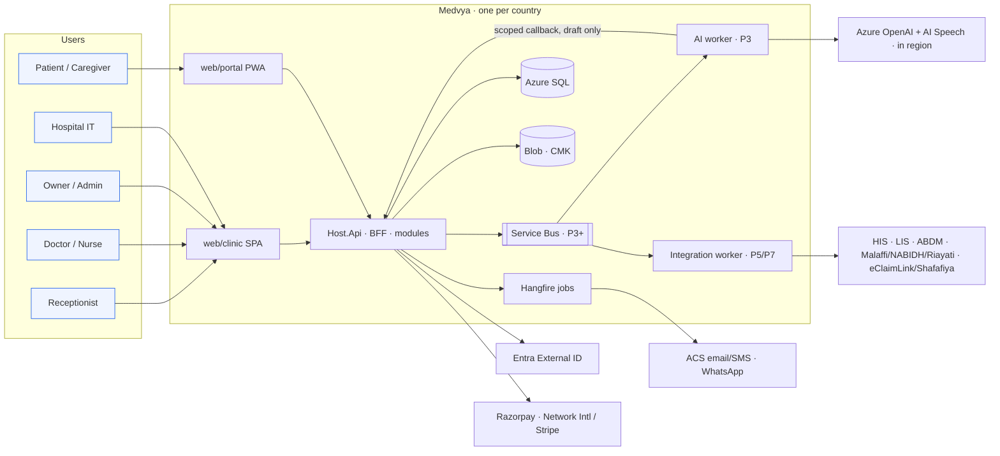

# Architecture

**Shape:** one ASP.NET Core (.NET 10 LTS) modular monolith per country. It contains the BFF and the public Razor site, with React 19 + shadcn/ui/Tailwind SPAs for staff (`web/clinic`) and patients (`web/portal`). The database is Azure SQL Database (one logical server per country). Jobs run on Hangfire on Azure SQL in P1, plus Azure Service Bus with .NET workers for AI and integrations from P3. Hosting is Azure App Service (Linux) until P7 stamps.

| File | Content |
|---|---|
| [../01-prd/technology-and-db-security.md](../01-prd/technology-and-db-security.md) | Authoritative stack table (PRD v2 §07), DB comparison, 12 protection layers |
| [repository-structure.md](repository-structure.md) | Proposed monorepo tree and repository rules |
| [frontend-architecture.md](frontend-architecture.md) | **Hard rule:** domain-driven feature folders, controller hooks, presentational components, TanStack Query / React Hook Form placement (lint-enforced) |
| [modules.md](modules.md) | Module ownership, invariants, endpoints, domain events |
| [data-classification.md](data-classification.md) | Classification register: every planned P0–P2 field with its class and controls; Always Encrypted and masking sets |
| [database-security.md](database-security.md) | Database roles (migrator, app, per-module, reporting), `infra/sql/roles.sql`, mapping to Entra managed identities |
| [data-model.md](data-model.md) | ERD for Azure SQL: conventions, Postgres → Azure SQL mapping, data classification, constraints |
| [state-machines.md](state-machines.md) | Capture FSM, care-task lifecycle, appointment/visit, invoice, write-back, membership |
| [api-sketch.md](api-sketch.md) | MVP endpoint sketch and API rules |
| [azure-deployment.md](azure-deployment.md) | P0 environment resources, stages 1–4, scaling, DR, cost guidance |
| [ai-pipeline.md](ai-pipeline.md) | Ambient note pipeline, AI worker privileges, evaluation and release gate |
| [integrations.md](integrations.md) | Messaging, payments, identity, ABDM, UAE HIEs, claims, HL7/FHIR, migration |

## Context (C4 level 1)

## Trust boundaries (Software Architecture §2)

- **Device/phone → cloud:** untrusted edge. Scoped upload, authenticated encounter context, TLS, replay rejection.
- **Browser → API:** authentication is not authorisation. Every request checks tenant membership, facility, role, patient relationship, purpose and encounter state.
- **Application → AI:** bounded input, no unrestricted tool calls, no authority to sign or dispatch, one permitted AI provider per environment.
- **Application → hospital:** contract-governed. Least-privilege technical identity, explicit patient/encounter matching, idempotent write-back, confirmed receipt.
- **Monitoring:** opaque IDs, timings and error types only. Never transcript, audio, names, ABHA, MRN or clinical text.
