# Entity-relationship diagram and application map

> **Generated.** Do not edit by hand. Regenerate with `python3 -I tools/erd/generate.py` after any change to an EF Core model or migration, and commit the result in the same PR. CI runs `python3 -I tools/erd/generate.py --check` and fails when this file is stale (AGENTS.md section 3).

**What is exact and what is inferred**

- *Exact:* every table, column, type, key, nullability, database foreign key and JSON column comes from the EF Core model snapshots (`src/Modules/*/*/Persistence/Migrations/*ModelSnapshot.cs`), and module dependencies from the `.csproj` references.
- *Inferred from column names:* the dotted cross-module links (for example `Appointments.PatientId` to `patients.Patients`). They are **not** database foreign keys: a module never touches another module's tables (AGENTS.md 3.1), so the link is an id the application resolves through a service. The mapping is the `SOFT_REFS` table in `tools/erd/generate.py`.
- *Planned:* the full-feature model in section 5 is read from `docs/03-architecture/data-model.md`; it is a plan, not a schema.

## 1. How the application is linked

One deployable (`Host.Api`) serves the web apps and every module; modules are separate projects that call each other only through application services and contracts; each module owns one SQL schema in one Azure SQL database per country.

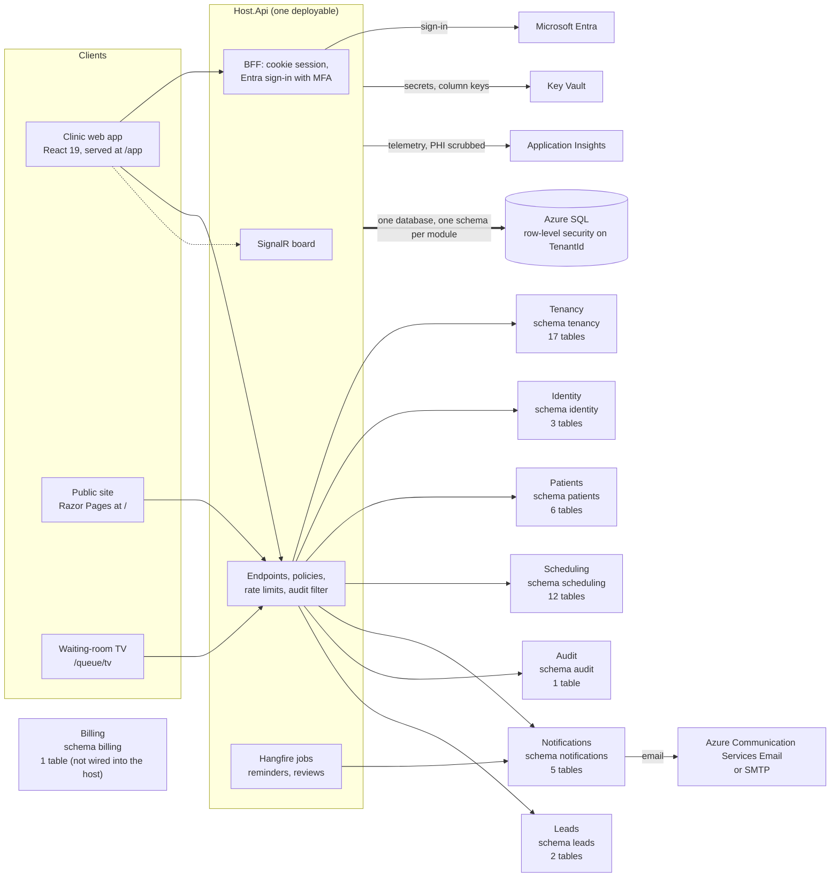

## 2. Which module uses which (project references)

An arrow means the project of the first module references the application, domain or API project of the second. Read from the `.csproj` files.

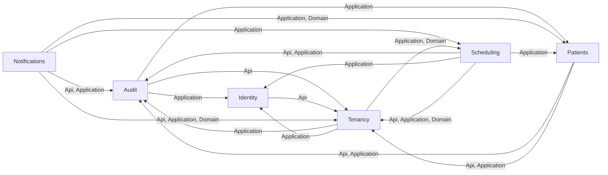

`Host.Api` references: Audit, Identity, Leads, Notifications, Patients, Scheduling, Tenancy. Modules with no incoming arrow from another module: Billing, Leads, Notifications.

## 3. How the data links across modules

Dotted lines are ids that point to another module's table without a database foreign key. The label lists up to three columns; `...` means more.

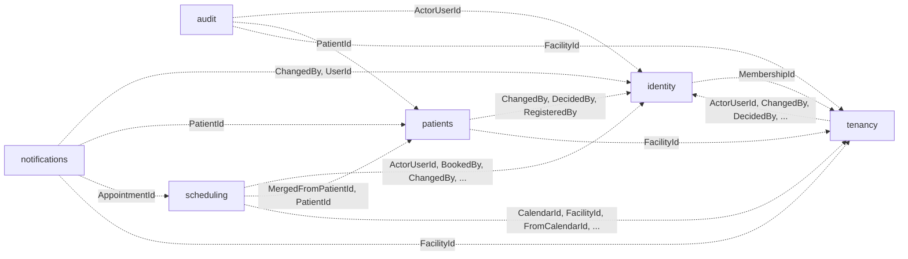

Every tenant-scoped table also carries `TenantId`; it is left out of the picture because it links all modules to `tenancy.Tenants`.

## 4. Tables by module

### Tenancy (schema `tenancy`, 17 tables)

```mermaid
erDiagram
  AccessReviews {
    guid Id PK
  }
  AccessReviewDecisions {
    guid ReviewId PK "id of tenancy.AccessReviews"
    guid MembershipId PK "id of tenancy.Memberships"
    guid DecidedBy "id of identity.Users"
  }
  Closures {
    guid Id PK
    guid FacilityId FK "FK to Facilities"
  }
  CustomRoles {
    guid Id PK
  }
  DoctorLicences {
    guid MembershipId PK, FK "FK to Memberships"
    guid VerifiedBy "id of identity.Users"
  }
  DoctorProfiles {
    guid MembershipId PK, FK "FK to Memberships"
    guid ChangedBy "id of identity.Users"
  }
  Facilities {
    guid Id PK
  }
  FeatureFlags {
    guid Id PK
    guid ChangedBy "id of identity.Users"
  }
  Invitations {
    guid Id PK
    guid MembershipId FK "FK to Memberships"
  }
  Memberships {
    guid Id PK
    guid CustomRoleId FK "FK to CustomRoles"
    guid FacilityId FK "FK to Facilities"
    guid UserId "id of identity.Users"
  }
  OperatingHours {
    guid Id PK
    guid FacilityId FK "FK to Facilities"
  }
  PracticeDefaults {
    guid TenantId PK, FK "FK to Tenants"
  }
  Profiles {
    guid Id PK
    guid ChangedBy "id of identity.Users"
  }
  SettingsChanges {
    guid Id PK
    guid ActorUserId "id of identity.Users"
  }
  Tenants {
    guid Id PK
  }
  TenantIndex {
    guid TenantId PK "id of tenancy.Tenants"
  }
  TermsAcceptances {
    guid Id PK
  }
  identity_Users {
    guid Id PK "other module"
  }
  Tenants ||--o{ AccessReviews : "TenantId"
  AccessReviews ||..o{ AccessReviewDecisions : "ReviewId, no FK"
  Memberships ||..o{ AccessReviewDecisions : "MembershipId, no FK"
  identity_Users |o..o{ AccessReviewDecisions : "DecidedBy"
  Facilities ||--o{ Closures : "FacilityId"
  Tenants ||--o{ CustomRoles : "TenantId"
  Memberships ||--o{ DoctorLicences : "MembershipId"
  identity_Users |o..o{ DoctorLicences : "VerifiedBy"
  Memberships ||--o{ DoctorProfiles : "MembershipId"
  identity_Users |o..o{ DoctorProfiles : "ChangedBy"
  Tenants ||--o{ Facilities : "TenantId"
  Tenants ||--o{ FeatureFlags : "TenantId"
  identity_Users |o..o{ FeatureFlags : "ChangedBy"
  Memberships ||--o{ Invitations : "MembershipId"
  CustomRoles |o--o{ Memberships : "CustomRoleId"
  Facilities ||--o{ Memberships : "FacilityId"
  identity_Users |o..o{ Memberships : "UserId"
  Facilities ||--o{ OperatingHours : "FacilityId"
  Tenants ||--o{ PracticeDefaults : "TenantId"
  Tenants ||--o{ Profiles : "TenantId"
  identity_Users |o..o{ Profiles : "ChangedBy"
  Tenants ||--o{ SettingsChanges : "TenantId"
  identity_Users |o..o{ SettingsChanges : "ActorUserId"
  Tenants ||--o{ TermsAcceptances : "TenantId"
```

| Table | Columns | Primary key | Notes |
|---|---|---|---|
| `AccessReviews` | 5 | Id | tenant-scoped |
| `AccessReviewDecisions` | 6 | ReviewId, MembershipId | tenant-scoped |
| `Closures` | 5 | Id | tenant-scoped |
| `CustomRoles` | 6 | Id | tenant-scoped |
| `DoctorLicences` | 12 | MembershipId | tenant-scoped |
| `DoctorProfiles` | 11 | MembershipId | tenant-scoped |
| `Facilities` | 5 | Id | tenant-scoped |
| `FeatureFlags` | 10 | Id | tenant-scoped |
| `Invitations` | 10 | Id | tenant-scoped |
| `Memberships` | 7 | Id | tenant-scoped |
| `OperatingHours` | 6 | Id | tenant-scoped |
| `PracticeDefaults` | 11 | TenantId | tenant-scoped |
| `Profiles` | 10 | Id | tenant-scoped |
| `SettingsChanges` | 8 | Id | tenant-scoped |
| `Tenants` | 5 | Id |  |
| `TenantIndex` | 1 | TenantId | tenant-scoped |
| `TermsAcceptances` | 5 | Id | append-only ledger; tenant-scoped |

<code>tenancy.AccessReviews</code> columns

| Column | Type | Null | Links to |
|---|---|---|---|
| `Id` | guid |  |  |
| `CompletedAt` | datetimeoffset | yes |  |
| `Quarter` | nvarchar(8) |  |  |
| `StartedAt` | datetimeoffset |  |  |
| `TenantId` | guid |  | FK to `Tenant` |

<code>tenancy.AccessReviewDecisions</code> columns

| Column | Type | Null | Links to |
|---|---|---|---|
| `ReviewId` | guid |  |  |
| `MembershipId` | guid |  |  |
| `DecidedAt` | datetimeoffset |  |  |
| `DecidedBy` | guid | yes | id of `identity.Users` |
| `Decision` | nvarchar(20) |  |  |
| `TenantId` | guid |  | `tenancy.Tenants` |

<code>tenancy.Closures</code> columns

| Column | Type | Null | Links to |
|---|---|---|---|
| `Id` | guid |  |  |
| `Date` | date |  |  |
| `FacilityId` | guid |  | FK to `Facility` |
| `Name` | nvarchar(100) |  |  |
| `TenantId` | guid |  | `tenancy.Tenants` |

<code>tenancy.CustomRoles</code> columns

| Column | Type | Null | Links to |
|---|---|---|---|
| `Id` | guid |  |  |
| `BaseRole` | nvarchar(40) |  |  |
| `Capabilities` | nvarchar(400) |  |  |
| `CreatedAt` | datetimeoffset |  |  |
| `Name` | nvarchar(60) |  |  |
| `TenantId` | guid |  | FK to `Tenant` |

<code>tenancy.DoctorLicences</code> columns

| Column | Type | Null | Links to |
|---|---|---|---|
| `MembershipId` | guid |  | FK to `Membership` |
| `Authority` | nvarchar(20) |  |  |
| `Category` | nvarchar(40) |  |  |
| `CertificateName` | nvarchar(200) |  |  |
| `ExpiresOn` | date | yes |  |
| `Number` | nvarchar(20) |  |  |
| `RejectedAt` | datetimeoffset | yes |  |
| `RejectionReason` | nvarchar(500) |  |  |
| `SubmittedAt` | datetimeoffset |  |  |
| `TenantId` | guid |  | `tenancy.Tenants` |
| `VerifiedAt` | datetimeoffset | yes |  |
| `VerifiedBy` | guid | yes | id of `identity.Users` |

<code>tenancy.DoctorProfiles</code> columns

| Column | Type | Null | Links to |
|---|---|---|---|
| `MembershipId` | guid |  | FK to `Membership` |
| `ChangedAt` | datetimeoffset |  |  |
| `ChangedBy` | guid | yes | id of `identity.Users` |
| `FollowUpFeeMinor` | bigint |  |  |
| `FullName` | nvarchar(200) |  |  |
| `Languages` | nvarchar(200) |  |  |
| `NewVisitFeeMinor` | bigint |  |  |
| `Qualifications` | nvarchar(200) |  |  |
| `SignatureKey` | nvarchar(200) |  |  |
| `Specialty` | nvarchar(100) |  |  |
| `TenantId` | guid |  | `tenancy.Tenants` |

<code>tenancy.Facilities</code> columns

| Column | Type | Null | Links to |
|---|---|---|---|
| `Id` | guid |  |  |
| `Address` | nvarchar(500) |  |  |
| `Name` | nvarchar(200) |  |  |
| `TenantId` | guid |  | FK to `Tenant` |
| `TimeZone` | nvarchar(64) |  |  |

<code>tenancy.FeatureFlags</code> columns

| Column | Type | Null | Links to |
|---|---|---|---|
| `Id` | guid |  |  |
| `ChangedAt` | datetimeoffset |  |  |
| `ChangedBy` | guid | yes | id of `identity.Users` |
| `CreatedAt` | datetimeoffset |  |  |
| `CreatedBy` | guid | yes |  |
| `Description` | nvarchar(500) |  |  |
| `Enabled` | bool |  |  |
| `Key` | nvarchar(100) |  |  |
| `Owner` | nvarchar(100) |  |  |
| `TenantId` | guid |  | FK to `Tenant` |

<code>tenancy.Invitations</code> columns

| Column | Type | Null | Links to |
|---|---|---|---|
| `Id` | guid |  |  |
| `AcceptedAt` | datetimeoffset | yes |  |
| `CreatedAt` | datetimeoffset |  |  |
| `Email` | nvarchar(254) |  |  |
| `ExpiresAt` | datetimeoffset |  |  |
| `InvitedBy` | guid |  |  |
| `MembershipId` | guid |  | FK to `Membership` |
| `RevokedAt` | datetimeoffset | yes |  |
| `TenantId` | guid |  | `tenancy.Tenants` |
| `TokenHash` | binary(32) |  |  |

<code>tenancy.Memberships</code> columns

| Column | Type | Null | Links to |
|---|---|---|---|
| `Id` | guid |  |  |
| `CustomRoleId` | guid | yes | FK to `CustomRole` |
| `FacilityId` | guid |  | FK to `Facility` |
| `Role` | nvarchar(40) |  |  |
| `Status` | nvarchar(20) |  |  |
| `TenantId` | guid |  | `tenancy.Tenants` |
| `UserId` | guid | yes | id of `identity.Users` |

<code>tenancy.OperatingHours</code> columns

| Column | Type | Null | Links to |
|---|---|---|---|
| `Id` | guid |  |  |
| `Closes` | time |  |  |
| `FacilityId` | guid |  | FK to `Facility` |
| `Opens` | time |  |  |
| `TenantId` | guid |  | `tenancy.Tenants` |
| `Weekday` | int |  |  |

<code>tenancy.PracticeDefaults</code> columns

| Column | Type | Null | Links to |
|---|---|---|---|
| `TenantId` | guid |  | FK to `Tenant` |
| `Currency` | nchar(3) |  |  |
| `FollowUpFeeMinor` | bigint |  |  |
| `Languages` | nvarchar(200) |  |  |
| `NewVisitFeeMinor` | bigint |  |  |
| `NoteTemplates` | nvarchar(max) |  |  |
| `Qualifications` | nvarchar(200) |  |  |
| `SaturdayHours` | nvarchar(max) |  |  |
| `SlotMinutes` | int |  |  |
| `Specialty` | nvarchar(100) |  |  |
| `WeekdayHours` | nvarchar(max) |  |  |

<code>tenancy.Profiles</code> columns

| Column | Type | Null | Links to |
|---|---|---|---|
| `Id` | guid |  |  |
| `Address` | nvarchar(500) |  |  |
| `ChangedAt` | datetimeoffset |  |  |
| `ChangedBy` | guid | yes | id of `identity.Users` |
| `Email` | nvarchar(254) |  |  |
| `LogoKey` | nvarchar(200) |  |  |
| `Phone` | nvarchar(30) |  |  |
| `RegistrationNumber` | nvarchar(50) |  |  |
| `TaxNumber` | nvarchar(30) |  |  |
| `TenantId` | guid |  | FK to `Tenant` |

<code>tenancy.SettingsChanges</code> columns

| Column | Type | Null | Links to |
|---|---|---|---|
| `Id` | guid |  |  |
| `ActorUserId` | guid | yes | id of `identity.Users` |
| `After` | nvarchar(max) |  |  |
| `Before` | nvarchar(max) |  |  |
| `OccurredAt` | datetimeoffset |  |  |
| `ResourceId` | guid | yes |  |
| `Section` | nvarchar(40) |  |  |
| `TenantId` | guid |  | FK to `Tenant` |

<code>tenancy.Tenants</code> columns

| Column | Type | Null | Links to |
|---|---|---|---|
| `Id` | guid |  |  |
| `CountryCode` | nchar(2) |  |  |
| `IdleTimeoutMinutes` | int |  |  |
| `Name` | nvarchar(200) |  |  |
| `ResidencyRegion` | nvarchar(40) |  |  |

<code>tenancy.TenantIndex</code> columns

| Column | Type | Null | Links to |
|---|---|---|---|
| `TenantId` | guid |  | `tenancy.Tenants` |

<code>tenancy.TermsAcceptances</code> columns

| Column | Type | Null | Links to |
|---|---|---|---|
| `Id` | guid |  |  |
| `AcceptedAt` | datetimeoffset |  |  |
| `AcceptedBy` | guid |  |  |
| `TenantId` | guid |  | FK to `Tenant` |
| `TermsVersion` | nvarchar(32) |  |  |

### Identity (schema `identity`, 3 tables)

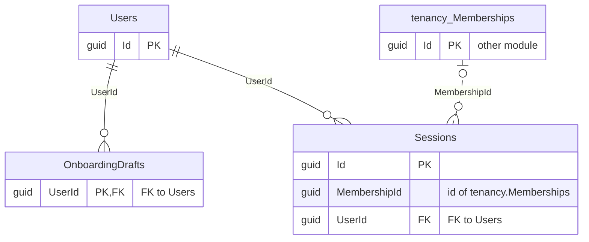

| Table | Columns | Primary key | Notes |
|---|---|---|---|
| `OnboardingDrafts` | 6 | UserId |  |
| `Sessions` | 9 | Id | tenant-scoped |
| `Users` | 4 | Id |  |

<code>identity.OnboardingDrafts</code> columns

| Column | Type | Null | Links to |
|---|---|---|---|
| `UserId` | guid |  | FK to `StaffUser` |
| `CompletedAt` | datetimeoffset | yes |  |
| `Country` | nchar(2) |  |  |
| `Data` | nvarchar(max) |  |  |
| `Step` | int |  |  |
| `UpdatedAt` | datetimeoffset |  |  |

<code>identity.Sessions</code> columns

| Column | Type | Null | Links to |
|---|---|---|---|
| `Id` | guid |  |  |
| `CreatedAt` | datetimeoffset |  |  |
| `Device` | nvarchar(64) |  |  |
| `IdleTimeoutMinutes` | int |  |  |
| `LastSeenAt` | datetimeoffset |  |  |
| `MembershipId` | guid | yes | id of `tenancy.Memberships` |
| `RevokedAt` | datetimeoffset | yes |  |
| `TenantId` | guid | yes | `tenancy.Tenants` |
| `UserId` | guid |  | FK to `StaffUser` |

<code>identity.Users</code> columns

| Column | Type | Null | Links to |
|---|---|---|---|
| `Id` | guid |  |  |
| `DisplayName` | nvarchar(200) |  |  |
| `Issuer` | nvarchar(256) |  |  |
| `Subject` | nvarchar(256) |  |  |

### Patients (schema `patients`, 6 tables)

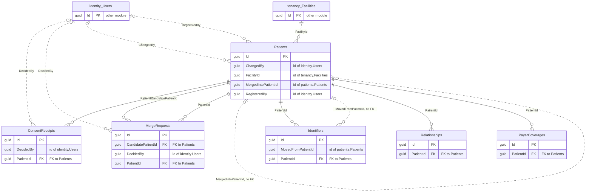

| Table | Columns | Primary key | Notes |
|---|---|---|---|
| `ConsentReceipts` | 10 | Id | append-only ledger; tenant-scoped |
| `MergeRequests` | 12 | Id | tenant-scoped |
| `Patients` | 24 | Id | tenant-scoped |
| `Identifiers` | 8 | Id | tenant-scoped |
| `Relationships` | 8 | Id | tenant-scoped |
| `PayerCoverages` | 9 | Id | tenant-scoped |

<code>patients.ConsentReceipts</code> columns

| Column | Type | Null | Links to |
|---|---|---|---|
| `Id` | guid |  |  |
| `Channel` | nvarchar(12) |  |  |
| `DecidedAt` | datetimeoffset |  |  |
| `DecidedBy` | guid | yes | id of `identity.Users` |
| `Granted` | bool |  |  |
| `Jurisdiction` | nvarchar(8) |  |  |
| `PatientId` | guid |  | FK to `Patient` |
| `PolicyVersion` | nvarchar(32) |  |  |
| `TenantId` | guid |  | `tenancy.Tenants` |
| `Type` | nvarchar(24) |  |  |

<code>patients.MergeRequests</code> columns

| Column | Type | Null | Links to |
|---|---|---|---|
| `Id` | guid |  |  |
| `CandidatePatientId` | guid |  | FK to `Patient` |
| `DecidedAt` | datetimeoffset |  |  |
| `DecidedBy` | guid | yes | id of `identity.Users` |
| `FirstApprovedBy` | guid | yes |  |
| `MergedAt` | datetimeoffset | yes |  |
| `PatientId` | guid |  | FK to `Patient` |
| `SecondApprovedBy` | guid | yes |  |
| `Status` | nvarchar(20) |  |  |
| `TenantId` | guid |  | `tenancy.Tenants` |
| `UnmergedAt` | datetimeoffset | yes |  |
| `UnmergedBy` | guid | yes |  |

<code>patients.Patients</code> columns

| Column | Type | Null | Links to |
|---|---|---|---|
| `Id` | guid |  |  |
| `AlternatePhone` | nvarchar(20) |  |  |
| `ArabicName` | nvarchar(200) |  |  |
| `ChangedAt` | datetimeoffset |  |  |
| `ChangedBy` | guid | yes | id of `identity.Users` |
| `CountryCode` | nchar(2) |  |  |
| `DateOfBirth` | date |  |  |
| `DateOfBirthEstimated` | bool |  |  |
| `Email` | nvarchar(254) |  |  |
| `FacilityId` | guid |  | id of `tenancy.Facilities` |
| `FullName` | nvarchar(200) |  |  |
| `GenderIdentity` | nvarchar(50) |  |  |
| `IdempotencyKeyHash` | nchar(64) |  |  |
| `IdempotencyRequestHash` | nchar(64) |  |  |
| `MergedIntoPatientId` | guid | yes | id of `patients.Patients` |
| `Mobile` | nvarchar(20) |  |  |
| `Mrn` | nvarchar(32) |  |  |
| `Nationality` | nchar(2) |  |  |
| `PreferredLanguage` | nvarchar(35) |  |  |
| `RegisteredAt` | datetimeoffset |  |  |
| `RegisteredBy` | guid | yes | id of `identity.Users` |
| `SexAtBirth` | nvarchar(20) |  |  |
| `Status` | nvarchar(20) |  |  |
| `TenantId` | guid |  | `tenancy.Tenants` |

<code>patients.Identifiers</code> columns

| Column | Type | Null | Links to |
|---|---|---|---|
| `Id` | guid |  |  |
| `DisplayValue` | nvarchar(64) |  |  |
| `ExpiresOn` | date | yes |  |
| `LookupValue` | nvarchar(64) |  |  |
| `MovedFromPatientId` | guid | yes | id of `patients.Patients` |
| `PatientId` | guid |  | FK to `Patient` |
| `Scheme` | nvarchar(20) |  |  |
| `TenantId` | guid |  | `tenancy.Tenants` |

<code>patients.Relationships</code> columns

| Column | Type | Null | Links to |
|---|---|---|---|
| `Id` | guid |  |  |
| `IsEmergencyContact` | bool |  |  |
| `IsGuardian` | bool |  |  |
| `Name` | nvarchar(200) |  |  |
| `PatientId` | guid |  | FK to `Patient` |
| `Phone` | nvarchar(20) |  |  |
| `Relationship` | nvarchar(20) |  |  |
| `TenantId` | guid |  | `tenancy.Tenants` |

<code>patients.PayerCoverages</code> columns

| Column | Type | Null | Links to |
|---|---|---|---|
| `Id` | guid |  |  |
| `Kind` | nvarchar(20) |  |  |
| `MemberNumber` | nvarchar(50) |  |  |
| `Network` | nvarchar(100) |  |  |
| `PatientId` | guid |  | FK to `Patient` |
| `PayerName` | nvarchar(200) |  |  |
| `Plan` | nvarchar(100) |  |  |
| `TenantId` | guid |  | `tenancy.Tenants` |
| `ValidTo` | date | yes |  |

### Scheduling (schema `scheduling`, 12 tables)

```mermaid
erDiagram
  Appointments {
    guid Id PK
    guid BookedBy "id of identity.Users"
    guid CalendarId "doctor or room"
    guid ChangedBy "id of identity.Users"
    guid FacilityId "id of tenancy.Facilities"
    guid MergedFromPatientId "id of patients.Patients"
    guid PatientId "id of patients.Patients"
  }
  AppointmentReschedules {
    guid Id PK
    guid ActorUserId "id of identity.Users"
    guid AppointmentId FK "FK to Appointments"
    guid FromCalendarId "doctor or room"
    guid ToCalendarId "doctor or room"
  }
  OutboxEvents {
    guid Id PK
  }
  OutboxTenants {
    guid TenantId PK "id of tenancy.Tenants"
  }
  QueueDisplays {
    guid Id PK
    guid FacilityId "id of tenancy.Facilities"
  }
  QueueTokens {
    guid Id PK
    guid AppointmentId FK "FK to Appointments"
    guid CalendarId "doctor or room"
    guid FacilityId "id of tenancy.Facilities"
  }
  ScheduleExceptions {
    guid Id PK
    guid CalendarId "doctor or room"
    guid FacilityId "id of tenancy.Facilities"
  }
  Resources {
    guid Id PK
    guid FacilityId "id of tenancy.Facilities"
  }
  ScheduleSlots {
    guid Id PK
    guid AppointmentId FK "FK to Appointments"
    guid CalendarId "doctor or room"
    guid FacilityId "id of tenancy.Facilities"
  }
  Templates {
    guid Id PK
    guid CalendarId "doctor or room"
    guid ChangedBy "id of identity.Users"
    guid FacilityId "id of tenancy.Facilities"
  }
  SlotHolds {
    guid Id PK
    guid CalendarId "doctor or room"
    guid FacilityId "id of tenancy.Facilities"
    guid HeldBy "id of identity.Users"
  }
  VisitStatusEvents {
    guid Id PK
    guid ActorUserId "id of identity.Users"
    guid AppointmentId FK "FK to Appointments"
  }
  identity_Users {
    guid Id PK "other module"
  }
  patients_Patients {
    guid Id PK "other module"
  }
  tenancy_Facilities {
    guid Id PK "other module"
  }
  tenancy_Memberships {
    guid Id PK "other module"
  }
  identity_Users |o..o{ Appointments : "BookedBy"
  tenancy_Memberships ||..o{ Appointments : "CalendarId (doctor calendar)"
  Resources ||..o{ Appointments : "CalendarId (room calendar)"
  identity_Users |o..o{ Appointments : "ChangedBy"
  tenancy_Facilities ||..o{ Appointments : "FacilityId"
  patients_Patients |o..o{ Appointments : "MergedFromPatientId"
  patients_Patients ||..o{ Appointments : "PatientId"
  Appointments ||--o{ AppointmentReschedules : "AppointmentId"
  identity_Users |o..o{ AppointmentReschedules : "ActorUserId"
  tenancy_Memberships ||..o{ AppointmentReschedules : "FromCalendarId (doctor calendar)"
  Resources ||..o{ AppointmentReschedules : "FromCalendarId (room calendar)"
  tenancy_Memberships ||..o{ AppointmentReschedules : "ToCalendarId (doctor calendar)"
  Resources ||..o{ AppointmentReschedules : "ToCalendarId (room calendar)"
  tenancy_Facilities ||..o{ QueueDisplays : "FacilityId"
  Appointments ||--o{ QueueTokens : "AppointmentId"
  tenancy_Memberships ||..o{ QueueTokens : "CalendarId (doctor calendar)"
  Resources ||..o{ QueueTokens : "CalendarId (room calendar)"
  tenancy_Facilities ||..o{ QueueTokens : "FacilityId"
  tenancy_Memberships ||..o{ ScheduleExceptions : "CalendarId (doctor calendar)"
  Resources ||..o{ ScheduleExceptions : "CalendarId (room calendar)"
  tenancy_Facilities ||..o{ ScheduleExceptions : "FacilityId"
  tenancy_Facilities ||..o{ Resources : "FacilityId"
  Appointments ||--o{ ScheduleSlots : "AppointmentId"
  tenancy_Memberships ||..o{ ScheduleSlots : "CalendarId (doctor calendar)"
  Resources ||..o{ ScheduleSlots : "CalendarId (room calendar)"
  tenancy_Facilities ||..o{ ScheduleSlots : "FacilityId"
  tenancy_Memberships ||..o{ Templates : "CalendarId (doctor calendar)"
  Resources ||..o{ Templates : "CalendarId (room calendar)"
  identity_Users |o..o{ Templates : "ChangedBy"
  tenancy_Facilities ||..o{ Templates : "FacilityId"
  tenancy_Memberships ||..o{ SlotHolds : "CalendarId (doctor calendar)"
  Resources ||..o{ SlotHolds : "CalendarId (room calendar)"
  tenancy_Facilities ||..o{ SlotHolds : "FacilityId"
  identity_Users ||..o{ SlotHolds : "HeldBy"
  Appointments ||--o{ VisitStatusEvents : "AppointmentId"
  identity_Users |o..o{ VisitStatusEvents : "ActorUserId"
```

| Table | Columns | Primary key | Notes |
|---|---|---|---|
| `Appointments` | 24 | Id | tenant-scoped |
| `AppointmentReschedules` | 12 | Id | tenant-scoped |
| `OutboxEvents` | 7 | Id | tenant-scoped |
| `OutboxTenants` | 1 | TenantId | tenant-scoped |
| `QueueDisplays` | 9 | Id | tenant-scoped |
| `QueueTokens` | 9 | Id | tenant-scoped |
| `ScheduleExceptions` | 12 | Id | tenant-scoped |
| `Resources` | 6 | Id | tenant-scoped |
| `ScheduleSlots` | 6 | Id | tenant-scoped |
| `Templates` | 8 | Id | tenant-scoped |
| `SlotHolds` | 9 | Id | tenant-scoped |
| `VisitStatusEvents` | 8 | Id | tenant-scoped |

<code>scheduling.Appointments</code> columns

| Column | Type | Null | Links to |
|---|---|---|---|
| `Id` | guid |  |  |
| `BookedAt` | datetimeoffset |  |  |
| `BookedBy` | guid | yes | id of `identity.Users` |
| `CalendarId` | guid |  | doctor or room (`CalendarKind`) |
| `CalendarKind` | nvarchar(20) |  |  |
| `ChangedAt` | datetimeoffset |  |  |
| `ChangedBy` | guid | yes | id of `identity.Users` |
| `Channel` | nvarchar(20) |  |  |
| `End` | datetimeoffset |  |  |
| `FacilityId` | guid |  | id of `tenancy.Facilities` |
| `IdempotencyKeyHash` | nchar(64) |  |  |
| `IdempotencyRequestHash` | nchar(64) |  |  |
| `MergedFromPatientId` | guid | yes | id of `patients.Patients` |
| `PatientId` | guid |  | id of `patients.Patients` |
| `ReasonCategory` | nvarchar(30) |  |  |
| `ReasonText` | nvarchar(500) |  |  |
| `Room` | nvarchar(50) |  |  |
| `SeriesId` | guid | yes |  |
| `Start` | datetimeoffset |  |  |
| `State` | nvarchar(20) |  |  |
| `TenantId` | guid |  | `tenancy.Tenants` |
| `Unscheduled` | bool |  |  |
| `VisitType` | nvarchar(30) |  |  |
| `WalkIn` | bool |  |  |

<code>scheduling.AppointmentReschedules</code> columns

| Column | Type | Null | Links to |
|---|---|---|---|
| `Id` | guid |  |  |
| `ActorUserId` | guid | yes | id of `identity.Users` |
| `AppointmentId` | guid |  | FK to `Appointment` |
| `FromCalendarId` | guid |  | doctor or room (`CalendarKind`) |
| `FromEnd` | datetimeoffset |  |  |
| `FromStart` | datetimeoffset |  |  |
| `OccurredAt` | datetimeoffset |  |  |
| `ReassignReason` | nvarchar(30) |  |  |
| `TenantId` | guid |  | `tenancy.Tenants` |
| `ToCalendarId` | guid |  | doctor or room (`CalendarKind`) |
| `ToEnd` | datetimeoffset |  |  |
| `ToStart` | datetimeoffset |  |  |

<code>scheduling.OutboxEvents</code> columns

| Column | Type | Null | Links to |
|---|---|---|---|
| `Id` | guid |  |  |
| `AggregateId` | guid |  |  |
| `OccurredAt` | datetimeoffset |  |  |
| `Payload` | nvarchar(max) |  |  |
| `PublishedAt` | datetimeoffset | yes |  |
| `TenantId` | guid |  | `tenancy.Tenants` |
| `Type` | nvarchar(100) |  |  |

<code>scheduling.OutboxTenants</code> columns

| Column | Type | Null | Links to |
|---|---|---|---|
| `TenantId` | guid |  | `tenancy.Tenants` |

<code>scheduling.QueueDisplays</code> columns

| Column | Type | Null | Links to |
|---|---|---|---|
| `Id` | guid |  |  |
| `CreatedAt` | datetimeoffset |  |  |
| `CreatedBy` | guid | yes |  |
| `FacilityId` | guid |  | id of `tenancy.Facilities` |
| `Name` | nvarchar(60) |  |  |
| `RevokedAt` | datetimeoffset | yes |  |
| `RevokedBy` | guid | yes |  |
| `TenantId` | guid |  | `tenancy.Tenants` |
| `TokenHash` | varbinary(32) |  |  |

<code>scheduling.QueueTokens</code> columns

| Column | Type | Null | Links to |
|---|---|---|---|
| `Id` | guid |  |  |
| `AppointmentId` | guid |  | FK to `Appointment` |
| `CalendarId` | guid |  | doctor or room (`CalendarKind`) |
| `Date` | date |  |  |
| `FacilityId` | guid |  | id of `tenancy.Facilities` |
| `IssuedAt` | datetimeoffset |  |  |
| `Number` | int |  |  |
| `Prefix` | nvarchar(4) |  |  |
| `TenantId` | guid |  | `tenancy.Tenants` |

<code>scheduling.ScheduleExceptions</code> columns

| Column | Type | Null | Links to |
|---|---|---|---|
| `Id` | guid |  |  |
| `CalendarId` | guid |  | doctor or room (`CalendarKind`) |
| `CreatedAt` | datetimeoffset |  |  |
| `CreatedBy` | guid | yes |  |
| `End` | time | yes |  |
| `FacilityId` | guid |  | id of `tenancy.Facilities` |
| `FromDate` | date |  |  |
| `Kind` | nvarchar(20) |  |  |
| `Reason` | nvarchar(60) |  |  |
| `Start` | time | yes |  |
| `TenantId` | guid |  | `tenancy.Tenants` |
| `ToDate` | date |  |  |

<code>scheduling.Resources</code> columns

| Column | Type | Null | Links to |
|---|---|---|---|
| `Id` | guid |  |  |
| `CreatedAt` | datetimeoffset |  |  |
| `CreatedBy` | guid | yes |  |
| `FacilityId` | guid |  | id of `tenancy.Facilities` |
| `Name` | nvarchar(100) |  |  |
| `TenantId` | guid |  | `tenancy.Tenants` |

<code>scheduling.ScheduleSlots</code> columns

| Column | Type | Null | Links to |
|---|---|---|---|
| `Id` | guid |  |  |
| `AppointmentId` | guid |  | FK to `Appointment` |
| `CalendarId` | guid |  | doctor or room (`CalendarKind`) |
| `FacilityId` | guid |  | id of `tenancy.Facilities` |
| `SlotStart` | datetimeoffset |  |  |
| `TenantId` | guid |  | `tenancy.Tenants` |

<code>scheduling.Templates</code> columns

| Column | Type | Null | Links to |
|---|---|---|---|
| `Id` | guid |  |  |
| `CalendarId` | guid |  | doctor or room (`CalendarKind`) |
| `CalendarKind` | nvarchar(20) |  |  |
| `ChangedAt` | datetimeoffset |  |  |
| `ChangedBy` | guid | yes | id of `identity.Users` |
| `FacilityId` | guid |  | id of `tenancy.Facilities` |
| `SlotMinutes` | int |  |  |
| `TenantId` | guid |  | `tenancy.Tenants` |

<code>scheduling.SlotHolds</code> columns

| Column | Type | Null | Links to |
|---|---|---|---|
| `Id` | guid |  |  |
| `CalendarId` | guid |  | doctor or room (`CalendarKind`) |
| `End` | datetimeoffset |  |  |
| `ExpiresAt` | datetimeoffset |  |  |
| `FacilityId` | guid |  | id of `tenancy.Facilities` |
| `HeldBy` | guid |  | id of `identity.Users` |
| `Start` | datetimeoffset |  |  |
| `TenantId` | guid |  | `tenancy.Tenants` |
| `VisitType` | nvarchar(30) |  |  |

<code>scheduling.VisitStatusEvents</code> columns

| Column | Type | Null | Links to |
|---|---|---|---|
| `Id` | guid |  |  |
| `ActorUserId` | guid | yes | id of `identity.Users` |
| `AppointmentId` | guid |  | FK to `Appointment` |
| `CancelReason` | nvarchar(30) |  |  |
| `Note` | nvarchar(500) |  |  |
| `OccurredAt` | datetimeoffset |  |  |
| `State` | nvarchar(20) |  |  |
| `TenantId` | guid |  | `tenancy.Tenants` |

### Notifications (schema `notifications`, 5 tables)

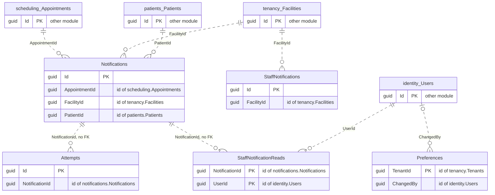

| Table | Columns | Primary key | Notes |
|---|---|---|---|
| `Notifications` | 17 | Id | tenant-scoped |
| `Attempts` | 6 | Id | tenant-scoped |
| `Preferences` | 11 | TenantId | tenant-scoped |
| `StaffNotifications` | 8 | Id | tenant-scoped |
| `StaffNotificationReads` | 4 | NotificationId, UserId | tenant-scoped |

<code>notifications.Notifications</code> columns

| Column | Type | Null | Links to |
|---|---|---|---|
| `Id` | guid |  |  |
| `AppointmentId` | guid |  | id of `scheduling.Appointments` |
| `AppointmentStart` | datetimeoffset |  |  |
| `Attempts` | int |  |  |
| `Channel` | nvarchar(10) |  |  |
| `CreatedAt` | datetimeoffset |  |  |
| `FacilityId` | guid |  | id of `tenancy.Facilities` |
| `FailureCode` | nvarchar(60) |  |  |
| `Kind` | nvarchar(20) |  |  |
| `NextAttemptAt` | datetimeoffset | yes |  |
| `PatientId` | guid |  | id of `patients.Patients` |
| `ProviderRef` | nvarchar(80) |  |  |
| `SendAt` | datetimeoffset |  |  |
| `SourceEventId` | guid |  |  |
| `Status` | nvarchar(20) |  |  |
| `TenantId` | guid |  | `tenancy.Tenants` |
| `UpdatedAt` | datetimeoffset |  |  |

<code>notifications.Attempts</code> columns

| Column | Type | Null | Links to |
|---|---|---|---|
| `Id` | guid |  |  |
| `At` | datetimeoffset |  |  |
| `Code` | nvarchar(60) |  |  |
| `NotificationId` | guid |  | id of `notifications.Notifications` |
| `Outcome` | nvarchar(20) |  |  |
| `TenantId` | guid |  | `tenancy.Tenants` |

<code>notifications.Preferences</code> columns

| Column | Type | Null | Links to |
|---|---|---|---|
| `TenantId` | guid |  | `tenancy.Tenants` |
| `ChangedAt` | datetimeoffset |  |  |
| `ChangedBy` | guid | yes | id of `identity.Users` |
| `Changes` | bool |  |  |
| `Confirmation` | bool |  |  |
| `Email` | bool |  |  |
| `QuietEnd` | time |  |  |
| `QuietStart` | time |  |  |
| `Reminder24h` | bool |  |  |
| `Reminder2h` | bool |  |  |
| `Sms` | bool |  |  |

<code>notifications.StaffNotifications</code> columns

| Column | Type | Null | Links to |
|---|---|---|---|
| `Id` | guid |  |  |
| `CreatedAt` | datetimeoffset |  |  |
| `DedupeKey` | nvarchar(80) |  |  |
| `Detail` | int | yes |  |
| `FacilityId` | guid |  | id of `tenancy.Facilities` |
| `Kind` | nvarchar(30) |  |  |
| `RefId` | guid | yes |  |
| `TenantId` | guid |  | `tenancy.Tenants` |

<code>notifications.StaffNotificationReads</code> columns

| Column | Type | Null | Links to |
|---|---|---|---|
| `NotificationId` | guid |  |  |
| `UserId` | guid |  |  |
| `ReadAt` | datetimeoffset |  |  |
| `TenantId` | guid |  | `tenancy.Tenants` |

### Audit (schema `audit`, 1 table)

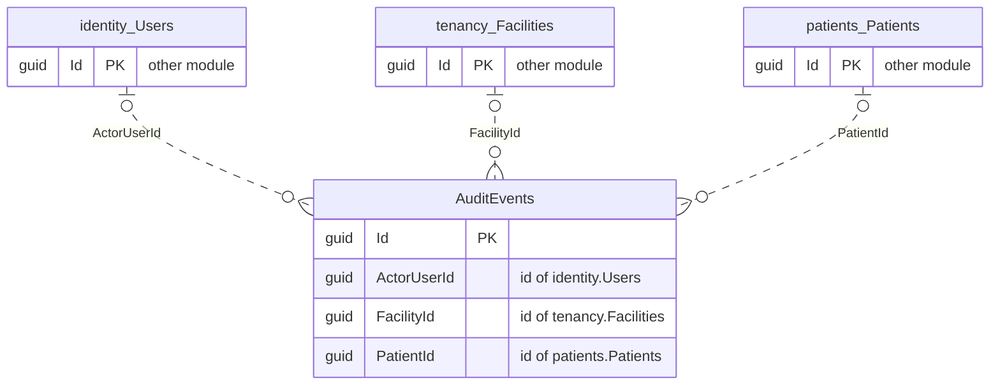

| Table | Columns | Primary key | Notes |
|---|---|---|---|
| `AuditEvents` | 15 | Id | append-only ledger; tenant-scoped |

<code>audit.AuditEvents</code> columns

| Column | Type | Null | Links to |
|---|---|---|---|
| `Id` | guid |  |  |
| `Action` | nvarchar(64) |  |  |
| `ActorUserId` | guid | yes | id of `identity.Users` |
| `ClientIp` | nvarchar(45) |  |  |
| `CorrelationId` | nvarchar(64) |  |  |
| `Detail` | nvarchar(256) |  |  |
| `FacilityId` | guid | yes | id of `tenancy.Facilities` |
| `OccurredAt` | datetimeoffset |  |  |
| `Outcome` | nvarchar(16) |  |  |
| `PatientId` | guid | yes | id of `patients.Patients` |
| `Purpose` | nvarchar(32) |  |  |
| `ResourceId` | guid | yes |  |
| `ResourceType` | nvarchar(64) |  |  |
| `Role` | nvarchar(32) |  |  |
| `TenantId` | guid |  | `tenancy.Tenants` |

### Leads (schema `leads`, 2 tables)

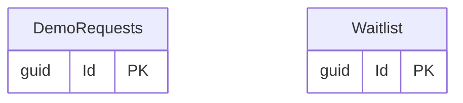

| Table | Columns | Primary key | Notes |
|---|---|---|---|
| `DemoRequests` | 11 | Id |  |
| `Waitlist` | 8 | Id |  |

<code>leads.DemoRequests</code> columns

| Column | Type | Null | Links to |
|---|---|---|---|
| `Id` | guid |  |  |
| `ConsentedAt` | datetimeoffset | yes |  |
| `Country` | varchar(5) |  |  |
| `Email` | nvarchar(254) |  |  |
| `Message` | nvarchar(1000) |  |  |
| `Name` | nvarchar(100) |  |  |
| `NoticeVersion` | varchar(20) |  |  |
| `Organisation` | nvarchar(150) |  |  |
| `Phone` | varchar(20) |  |  |
| `ReceivedAt` | datetimeoffset |  |  |
| `Role` | nvarchar(100) |  |  |

<code>leads.Waitlist</code> columns

| Column | Type | Null | Links to |
|---|---|---|---|
| `Id` | guid |  |  |
| `ConsentedAt` | datetimeoffset | yes |  |
| `Country` | varchar(2) |  |  |
| `Email` | nvarchar(254) |  |  |
| `Name` | nvarchar(100) |  |  |
| `NoticeVersion` | varchar(20) |  |  |
| `Phone` | varchar(20) |  |  |
| `ReceivedAt` | datetimeoffset |  |  |

### Billing (schema `billing`, 1 table)

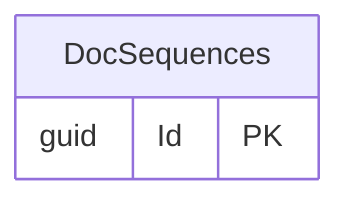

| Table | Columns | Primary key | Notes |
|---|---|---|---|
| `DocSequences` | 7 | Id | tenant-scoped |

<code>billing.DocSequences</code> columns

| Column | Type | Null | Links to |
|---|---|---|---|
| `Id` | guid |  |  |
| `CountryCode` | nchar(2) |  |  |
| `DocumentType` | nvarchar(20) |  |  |
| `FinancialYear` | nvarchar(5) |  |  |
| `NextNumber` | bigint |  |  |
| `Prefix` | nvarchar(16) |  |  |
| `TenantId` | guid |  | `tenancy.Tenants` |

## 5. Whole application: built and planned

From `docs/03-architecture/data-model.md` (areas A to D). "Built" means a table exists in the snapshots; some are narrower than the plan.

| Area | Planned entity | Status | Built as |
|---|---|---|---|
| A · Tenant, practice, PMS, billing | `TENANT` | built | `tenancy.Tenants` |
| A · Tenant, practice, PMS, billing | `FACILITY` | built | `tenancy.Facilities` |
| A · Tenant, practice, PMS, billing | `DEPARTMENT` | not built | |
| A · Tenant, practice, PMS, billing | `USER` | built | `identity.Users` |
| A · Tenant, practice, PMS, billing | `MEMBERSHIP` | built | `tenancy.Memberships` |
| A · Tenant, practice, PMS, billing | `ROLE` | partly built | `tenancy.CustomRoles` (custom roles only; the built-in roles are in code (RoleMatrix)) |
| A · Tenant, practice, PMS, billing | `ROLE_PERMISSION` | not built | |
| A · Tenant, practice, PMS, billing | `CLINICIAN_PROFILE` | built | `tenancy.DoctorProfiles` |
| A · Tenant, practice, PMS, billing | `CLINICIAN_LICENCE` | built | `tenancy.DoctorLicences` |
| A · Tenant, practice, PMS, billing | `SCHEDULE_TEMPLATE` | built | `scheduling.Templates` |
| A · Tenant, practice, PMS, billing | `LEAVE` | partly built | `scheduling.ScheduleExceptions` (also holds extra sessions and shortened days) |
| A · Tenant, practice, PMS, billing | `HOLIDAY` | built | `tenancy.Closures` |
| A · Tenant, practice, PMS, billing | `PATIENT` | built | `patients.Patients` |
| A · Tenant, practice, PMS, billing | `PATIENT_IDENTIFIER` | built | `patients.Identifiers` |
| A · Tenant, practice, PMS, billing | `PATIENT_RELATIONSHIP` | built | `patients.Relationships` |
| A · Tenant, practice, PMS, billing | `PAYER_COVERAGE` | built | `patients.PayerCoverages` |
| A · Tenant, practice, PMS, billing | `CONSENT_RECEIPT` | partly built | `patients.ConsentReceipts` (registration consents; the per-encounter recording consent in area C is not built) |
| A · Tenant, practice, PMS, billing | `SCHEDULE_SLOT` | built | `scheduling.ScheduleSlots` |
| A · Tenant, practice, PMS, billing | `APPOINTMENT` | built | `scheduling.Appointments` |
| A · Tenant, practice, PMS, billing | `WAITLIST_ENTRY` | not built | |
| A · Tenant, practice, PMS, billing | `QUEUE_TOKEN` | built | `scheduling.QueueTokens` |
| A · Tenant, practice, PMS, billing | `SERVICE_CATALOGUE` | not built | |
| A · Tenant, practice, PMS, billing | `PRICE_VERSION` | not built | |
| A · Tenant, practice, PMS, billing | `PACKAGE` | not built | |
| A · Tenant, practice, PMS, billing | `INVOICE` | not built | |
| A · Tenant, practice, PMS, billing | `INVOICE_LINE` | not built | |
| A · Tenant, practice, PMS, billing | `PAYMENT` | not built | |
| A · Tenant, practice, PMS, billing | `PAYMENT_SPLIT` | not built | |
| A · Tenant, practice, PMS, billing | `DOC_SEQUENCE` | partly built | `billing.DocSequences` (numbering only; invoices and payments are not built) |
| A · Tenant, practice, PMS, billing | `PACKAGE_ENROLMENT` | not built | |
| A · Tenant, practice, PMS, billing | `REDEMPTION` | not built | |
| A · Tenant, practice, PMS, billing | `DUE` | not built | |
| A · Tenant, practice, PMS, billing | `STATEMENT` | not built | |
| A · Tenant, practice, PMS, billing | `CASH_SESSION` | not built | |
| A · Tenant, practice, PMS, billing | `CLAIM` | not built | |
| A · Tenant, practice, PMS, billing | `ELIGIBILITY_CHECK` | not built | |
| A · Tenant, practice, PMS, billing | `PRIOR_AUTH` | not built | |
| A · Tenant, practice, PMS, billing | `REMITTANCE` | not built | |
| A · Tenant, practice, PMS, billing | `CLAIM_RESUBMISSION` | not built | |
| B · EMR, clinical authority | `ENCOUNTER` | not built | |
| B · EMR, clinical authority | `OBSERVATION` | not built | |
| B · EMR, clinical authority | `PROBLEM` | not built | |
| B · EMR, clinical authority | `ALLERGY` | not built | |
| B · EMR, clinical authority | `MEDICATION_STATEMENT` | not built | |
| B · EMR, clinical authority | `CLINICAL_NOTE` | not built | |
| B · EMR, clinical authority | `NOTE_VERSION` | not built | |
| B · EMR, clinical authority | `CLINICIAN_SIGNATURE` | not built | |
| B · EMR, clinical authority | `CLINICAL_ORDER` | not built | |
| B · EMR, clinical authority | `CLINICAL_RESULT` | not built | |
| B · EMR, clinical authority | `PRESCRIPTION` | not built | |
| B · EMR, clinical authority | `PRESCRIPTION_ITEM` | not built | |
| B · EMR, clinical authority | `REFERRAL` | not built | |
| B · EMR, clinical authority | `PHARMACY_DISPATCH` | not built | |
| B · EMR, clinical authority | `FORMULARY_ITEM` | not built | |
| B · EMR, clinical authority | `ORDER_SET` | not built | |
| B · EMR, clinical authority | `CLINICAL_DOCUMENT` | not built | |
| B · EMR, clinical authority | `DOCUMENT_PROVENANCE` | not built | |
| B · EMR, clinical authority | `EXTERNAL_RECORD_LINK` | not built | |
| C · Consent, capture, AI | `CONSENT_RECEIPT` | not built | |
| C · Consent, capture, AI | `ENCOUNTER_PARTICIPANT` | not built | |
| C · Consent, capture, AI | `DEVICE` | not built | |
| C · Consent, capture, AI | `DEVICE_PAIRING` | not built | |
| C · Consent, capture, AI | `RECORDING_SESSION` | not built | |
| C · Consent, capture, AI | `AUDIO_CHUNK` | not built | |
| C · Consent, capture, AI | `TRANSCRIPT` | not built | |
| C · Consent, capture, AI | `TRANSCRIPT_SEGMENT` | not built | |
| C · Consent, capture, AI | `SPEAKER_LABEL` | not built | |
| C · Consent, capture, AI | `AI_JOB` | not built | |
| C · Consent, capture, AI | `AI_RUN` | not built | |
| C · Consent, capture, AI | `NOTE_DRAFT` | not built | |
| C · Consent, capture, AI | `EVIDENCE_LINK` | not built | |
| D · Care, portal, integration, audit | `CARE_PLAN` | not built | |
| D · Care, portal, integration, audit | `CARE_TASK` | not built | |
| D · Care, portal, integration, audit | `CARE_TASK_EVENT` | not built | |
| D · Care, portal, integration, audit | `INBOX_ITEM` | not built | |
| D · Care, portal, integration, audit | `REVIEW_ACKNOWLEDGEMENT` | not built | |
| D · Care, portal, integration, audit | `MESSAGE_THREAD` | not built | |
| D · Care, portal, integration, audit | `MESSAGE` | not built | |
| D · Care, portal, integration, audit | `NOTIFICATION` | partly built | `notifications.Notifications` (patient messages only; staff notifications are separate tables) |
| D · Care, portal, integration, audit | `NOTIFICATION_ATTEMPT` | built | `notifications.Attempts` |
| D · Care, portal, integration, audit | `PORTAL_ACCESS` | not built | |
| D · Care, portal, integration, audit | `PORTAL_PROXY` | not built | |
| D · Care, portal, integration, audit | `INTEGRATION_CONNECTION` | not built | |
| D · Care, portal, integration, audit | `EXTERNAL_PATIENT_MAP` | not built | |
| D · Care, portal, integration, audit | `EXTERNAL_RESOURCE_MAP` | not built | |
| D · Care, portal, integration, audit | `INTEGRATION_MESSAGE` | not built | |
| D · Care, portal, integration, audit | `DELIVERY` | not built | |
| D · Care, portal, integration, audit | `INTEGRATION_ATTEMPT` | not built | |
| D · Care, portal, integration, audit | `AUDIT_EVENT` | built | `audit.AuditEvents` |
| D · Care, portal, integration, audit | `OUTBOX_EVENT` | built | `scheduling.OutboxEvents` |

Tables that exist but were added while building (not named in the plan): `identity.OnboardingDrafts`, `identity.Sessions`, `leads.DemoRequests`, `leads.Waitlist`, `notifications.Preferences`, `notifications.StaffNotificationReads`, `notifications.StaffNotifications`, `patients.MergeRequests`, `scheduling.AppointmentReschedules`, `scheduling.OutboxTenants`, `scheduling.QueueDisplays`, `scheduling.Resources`, `scheduling.SlotHolds`, `scheduling.VisitStatusEvents`, `tenancy.AccessReviewDecisions`, `tenancy.AccessReviews`, `tenancy.FeatureFlags`, `tenancy.Invitations`, `tenancy.OperatingHours`, `tenancy.PracticeDefaults`, `tenancy.Profiles`, `tenancy.SettingsChanges`, `tenancy.TenantIndex`, `tenancy.TermsAcceptances`.

**Counts:** 47 tables across 8 schemas; 23 of 90 planned entities are built; 24 tables were added during the build.

## 6. Rules the model follows

- **Tenant isolation:** 42 of 47 tables carry `TenantId` (EF query filter plus SQL row-level security on `SESSION_CONTEXT`). Without `TenantId`: `identity.OnboardingDrafts`, `identity.Users`, `leads.DemoRequests`, `leads.Waitlist`, `tenancy.Tenants`. (`TenantId` present is not proof the row-level-security policy covers the table; see `docs/03-architecture/database-security.md`.)
- **Append-only ledgers:** `audit.AuditEvents`, `patients.ConsentReceipts`, `tenancy.TermsAcceptances` (`LEDGER = ON` in their migrations).
- **No cross-module foreign keys:** modules link by id and through application services (AGENTS.md 3.1).
- **Country data plane:** one deployment and one database per country (ADR-003); this diagram is the same in each.
- **Money** is integer minor units plus an ISO currency; **time** is `datetimeoffset` in UTC (AGENTS.md 3.4, 3.5).
