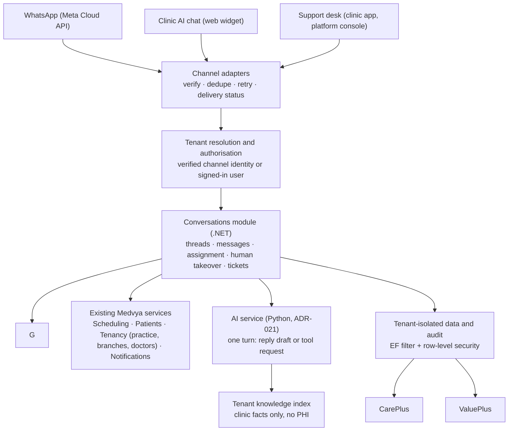

# ADR-022 · AI communication middleware: one conversation engine for WhatsApp, clinic chat and the support desk

- **Status:** Proposed 16 Nov 2026. Needs the owner's agreement before MDV-P4-036 starts. Ticket: MDV-P4-035.
- **Builds on:** [ADR-021](ADR-021-ai-service.md) (AI runs in the Python AI service), [ADR-004](ADR-004-bff-session.md) (no tokens in the browser), [ADR-005](ADR-005-tenant-isolation-rls.md) and [ADR-012](ADR-012-postgres.md) (two isolation layers), [ADR-014](ADR-014-platform-console.md) (platform console).

## Context

Three features need two-way conversations with patients and clinics:

1. **WhatsApp AI.** Patients book, reschedule and cancel, ask questions and get notifications in WhatsApp (PRD P4-09, MDV-P4-028 reminders).
2. **Clinic AI chat.** A clinic-specific assistant on the clinic's public page (P4-08) that answers from the clinic's own services, doctors, hours and policies.
3. **Support desk.** Patient-to-clinic messages with an AI reply draft that staff approve (P4-06, MDV-P4-019), and clinic-to-Medvya technical requests (MDV-P5-047), kept apart.

Built separately, they would be three backends with three tenant resolvers, three retry loops and three audit trails. Each tenant (synthetic examples: **CarePlus** and **ValuePlus**) needs its own WhatsApp business number, AI settings, knowledge and permissions. Patients, appointments, doctors and branches already exist in Medvya and must not be copied.

## Decision (proposed)

1. **One middleware, many channels.** A new .NET module, `Conversations` (`src/Modules/Conversations`), owns conversations, messages, participants, status, assignment, human takeover and tickets. Each channel is an adapter behind one interface: WhatsApp Cloud API, the web chat widget and the in-app inbox first; email and voice later without changing the core. The module is .NET because it holds records, tenancy and authorisation; only model calls go to the AI service.
2. **Tenant resolution from verified identity only, never from message content or a client-chosen header.**
   - WhatsApp: the `phone_number_id` of a webhook whose `X-Hub-Signature-256` verifies against the app secret maps to one channel account. That lookup table has no row-level security, like the invitation lookup. The request then runs inside that tenant's scope (`EnterLinkTenant`, as invitation and prescription links do).
   - Web chat: a public widget key plus an origin allow-list per tenant, rate-limited. It is not a secret and gives no access beyond the clinic's public assistant.
   - Staff and platform users: the existing session (cookie or native token).
3. **Strict tenant isolation.** Every conversation, message, ticket, knowledge entry, channel account and AI setting carries `tenant_id` under both layers (EF query filter and row-level security). Each tenant has its own WhatsApp business account and number, knowledge base, AI settings and permissions. Access tokens and app secrets are Key Vault references, never database values. Cross-tenant tests with CarePlus and ValuePlus cover every table and endpoint.
4. **AI orchestration in the AI service, tools executed by Medvya.** For each turn, Medvya sends the AI service the minimum context: the recent messages, the tenant's AI settings, retrieved clinic knowledge and the list of tools the caller is allowed to use. The AI service answers with either a reply or a tool request (for example `book_appointment(slot, service)`).
   - Medvya checks and runs the tool through the existing application service (Scheduling, Patients, Tenancy) with the verified patient identity, then sends the result back for the next turn.
   - The AI service never reaches Medvya's database or APIs on its own.
   - Guardrails, as in the receptionist proof of concept:
     - red-flag symptoms are caught in code before any model call and end in an emergency message and a staff alert;
     - no medical advice;
     - message text is untrusted input (prompt-injection defence);
     - each turn is audited with model, prompt hash and tool calls.
5. **What reaches WhatsApp.** Appointment facts (time, doctor, branch) and secure links only. Never results, notes, diagnoses or medicines (AGENTS.md 1.2). An existing patient is matched by verified phone number plus a one-time code before any booking change. The first message says the assistant is automated, and asking for a person hands over at any time.
6. **Support desk, two queues on one model.** Patient-to-clinic tickets are tenant data handled by clinic staff, with AI drafts approved by staff (MDV-P4-019). Clinic-to-Medvya tickets carry the tenant id but no patient data; the platform console sees them without any patient access, and diagnostics are scrubbed (MDV-P5-047).
7. **Asynchronous and recoverable.**
   - An inbound event is verified, stored once by provider message id (idempotent), acknowledged with 200, and then processed by a job (Hangfire today, Service Bus later).
   - Outbound sends retry with backoff, and delivery statuses update the message.
   - Telemetry carries ids, codes and timings only.
   - Templated one-way reminders stay in Notifications and send through the WhatsApp adapter.
8. **Central administration without patient data.** The platform console shows per-tenant integration health: webhook last seen, delivery failure rate, token expiry and template status. It also handles provisioning, subscriptions (plans gate the channels) and a per-tenant kill switch, all from counts and states, never message content (ADR-014).

## Not decided here

- The WhatsApp onboarding model (Embedded Signup with one business account per tenant, or numbers under a Medvya business account) and template approvals. That needs Meta approval, a person task (MDV-P4-032). Until then the adapter is tested against recorded webhook payloads and is **not** claimed to work with Meta.
- The knowledge index store (pgvector in the AI service database under row-level security, or Azure AI Search per country). Decided in MDV-P4-038.

## Not chosen

- **Three separate backends:** duplicated tenancy, retries and audit; channels could not share a thread or a handover.
- **Conversations inside the AI service:** would put records, tenancy and authorisation outside the .NET module rules and create a second source of truth (ADR-021 §2).
- **Letting the model call Medvya APIs directly:** the model would hold credentials and choose its own scope. Medvya executing an allow-listed tool keeps authorisation server-side (AGENTS.md 1.3).

## Consequences

- New module `Conversations`, new AI service endpoints for conversation turns and knowledge, and new tickets MDV-P4-035 to MDV-P4-043 (epic MDV-P4-E07). MDV-P4-019 and MDV-P5-047 build on the shared model.
- Off the pilot clinic flow (CLAUDE.md): build behind tenant flags after the pilot path is safe. WhatsApp go-live depends on Meta approvals.
